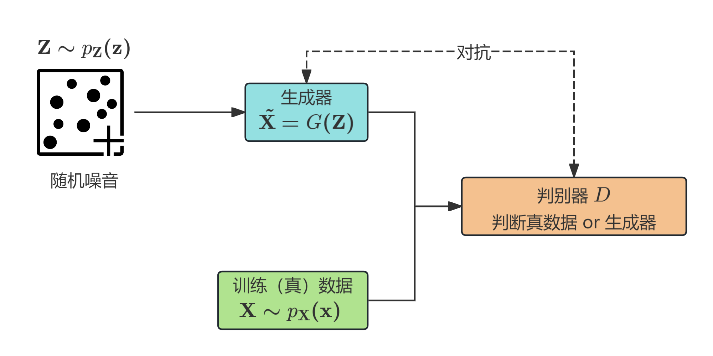
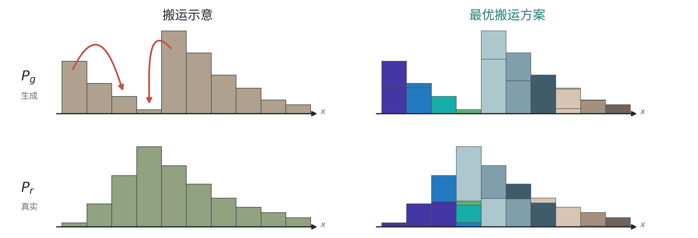
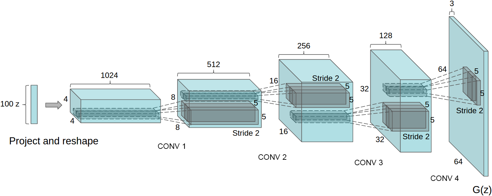
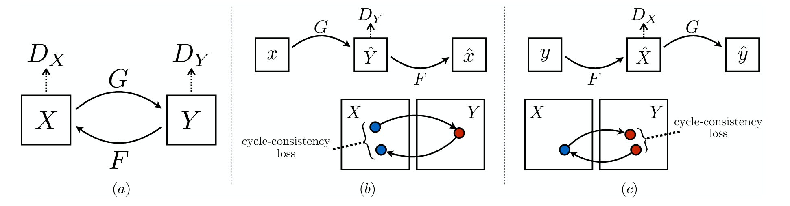
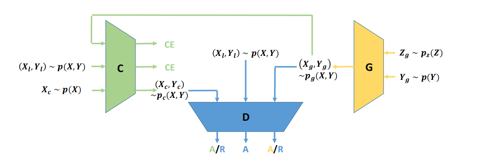

在[《机器学习方法》](/categories/机器学习方法/)中，我们已经对机器学习的生成模型（如朴素贝叶斯，GMM，HMM等）有了基本的认识。而随着神经网络与深度学习的发展，基于神经网络的深度生成模型逐渐兴起，其中的代表便是GAN、VAE与扩散模型。它们也是如今生成式人工智能的重要基石。
> 当然，神经网络与生成模型的结合最早可以追溯到1986年的RBM（受限玻尔兹曼机）和2006年的DBN（深度信念网络），只不过直到2014年左右GAN与VAE的出现才让深度生成模型为人所熟知。

# 生成对抗网络（GAN）
生成对抗网络于2014年由Ian Goodfellow等人提出。在其后的十余年里，各种变体不断涌现，成为深度生成模型中的一大家族。
+ 那么什么是GAN？顾名思义，GAN是一种特殊的神经网络，其通过一种称为对抗的方法进行训练，最终目标是生成数据。
    + 具体而言，给定随机向量$\mathbf{X}\sim p_{\mathbf{X}}(\mathbf{x})$，以及随机噪音向量$\mathbf{Z}\sim p_{\mathbf{Z}}(\mathbf{z})$， GAN的目标是找到函数$G$，使得$\tilde{\mathbf{X}}=G(\mathbf{Z})\sim p_{\mathbf{X}}(\mathbf{x})$。
    + GAN生成数据可用于生成图片、图片风格转换、图片修补、语音和文本生成等。
## 模型与算法
+ GAN的具体结构如下：
    其中生成器与判别器都是神经网络，其网络结构属于超参数。
+ 生成器G的任务: 输入随机噪音$\mathbf{Z}$（一个向量，维度为超参），输出假图片$G(\mathbf{Z})$，$G(\mathbf{Z})$的维度和真图片$\mathbf{X}$一致。
+ 判别器D的任务: 输入图片（真或假），输出一个$0$到$1$之间的标量，判断图片$\mathbf{X}$为真图片的概率
+ GAN的优化目标公式为：
    $$
    \min_G \max_D V(G, D) = \mathbb{E}_{\mathbf{x} \sim p_{\mathbf{X}}(\mathbf{x})}[\log D(\mathbf{x})] + \mathbb{E}_{\mathbf{z} \sim p_{\mathbf{Z}}(\mathbf{z})}[\log(1 - D(G(\mathbf{z})))]
    $$
    + 对于判别器$D$而言：如果输入的图片为真（$\mathbf{x} \sim p_{\mathbf{X}}(\mathbf{x})$），则要求 $D(\mathbf{x})$ 越大越好；如果输入的图片为假（$G(\mathbf{z})$, $\mathbf{z} \sim p_{\mathbf{Z}}(\mathbf{z})$），则要求 $D(G(\mathbf{z}))$ 越小越好。
    + 对于生成器$G$而言：它的目标是骗过判别器$D$，因此优化方向正好与$D$相反。
+ 实际上，GAN的优化目标与交叉熵损失函数具有密切联系：
    + 设判别器输入图片$\tilde{\mathbf{X}}$为真图片与生成图片的概率各为$\frac12$，并用二元标签$Y$表示是否为真图片。那么判别器的输出可看作二分类概率预测$P(Y=1|\tilde{\mathbf{X}})$，其对应的交叉熵损失为
        $$
        \begin{aligned}
        H(Y, D(\tilde{\mathbf{X}})) &= -\mathbb{E}_{(\tilde{\mathbf{X}}, Y)} [ Y \log D(\tilde{\mathbf{X}}) + (1 - Y) \log(1 - D(\tilde{\mathbf{X}})) ]\\
        &=-P(Y=1)\mathbb{E}_{\tilde{\mathbf{X}} \sim p_{\mathbf{X}}(\mathbf{x})}[\log D(\tilde{\mathbf{X}})]-P(Y=0)\mathbb{E}_{\tilde{\mathbf{X}} \sim p_{G}(\mathbf{x})}[\log(1 - D(\tilde{\mathbf{X}}))]\\   
        &=-\frac12 V(G,D)     
        \end{aligned}
        $$
+ GAN的优化算法步骤如下：
    1. 初始化$G$和$D$的参数$\theta_g$和$\theta_d$。
    2. 固定$G$，利用小批量梯度上升训练$D$的参数$\theta_d$。尝试最大化函数
        $$
        \mathbb{E}_{\mathbf{x} \sim p_\mathbf{X}(\mathbf{x})}[\log D(\mathbf{x})] + \mathbb{E}_{\mathbf{z} \sim p_\mathbf{Z}(\mathbf{z})}[\log(1 - D(G(\mathbf{z})))]
        $$
    3. 固定$D$，利用小批量梯度上升训练$G$的参数$\theta_g$。尝试最大化函数
        $$
        \mathbb{E}_{\mathbf{z} \sim p_\mathbf{Z}(\mathbf{z})}[\log D(G(\mathbf{z}))]
        $$
    4. 重复前两步，直到得到满意的结果。

    注意上面第三步中生成器的目标函数里采用了$\log D(G(\mathbf{z}))$而不是$\log(1 - D(G(\mathbf{z})))$，这是因为训练开始时，生成的图片质量肯定很差，因$G(\mathbf{z})$的取值会接近$0$。如果用$1-\log D$，其在零点附近的梯度比较小，参数更新会比较慢；而$\log D$在零点附近的梯度比较大，参数更新效率更高。
    + 在实际训练中，上述前两步的具体实现如下：
        1. 从真实图片里随机抽取样本$\{x_1, x_2, \cdots, x_m\} \sim p_\mathbf{X}(\mathbf{x})$；  
            随机抽取噪音样本$\{z_1, z_2, \cdots, z_m\} \sim p_\mathbf{Z}(\mathbf{z})$;   
            利用当前固定的生成器$G$生成假图片$\{\tilde{x}_1, \tilde{x}_2, \cdots, \tilde{x}_m\}, \tilde{x}_i = G(z_i)$;  
            更新判别器$D$的参数$\theta_d$：
            $$
            \theta_d \leftarrow \theta_d + \eta \times \nabla_{\theta_d} \frac{1}{m} \sum_{i=1}^m [\log D(x_i) + \log(1 - D(\tilde{x}_i))] 
            $$
            将上述过程重复$k$次。
        2. 随机抽取噪音样本$\{z_1, z_2, \cdots, z_m\} \sim p_\mathbf{Z}(\mathbf{z})$；  
            更新生成器$G$的参数$\theta_g$：
            $$ 
            \theta_g \leftarrow \theta_g + \eta \times \nabla_{\theta_g} \frac{1}{m} \sum_{i=1}^m \log D(G(z_i))
            $$
+ 另外，GAN在训练时会让$D$迭代$k$次后再迭代$G$一次，其具体原因如下：
    + 给定$G$情况下确定最优$D$：记$\tilde{\mathbf{X}} = G(\mathbf{z})$的分布为$p_G(\mathbf{x})$，则
        $$
        V(G, D) = \int_{\mathbf{x}} [p_{\mathbf{X}}(\mathbf{x})\log D(\mathbf{x}) + p_G(\mathbf{x})\log(1 - D(\mathbf{x}))]\mathrm{d}\mathbf{x}
        $$
        为了最大化$V(G, D)$，我们只需要对每个给定的$\mathbf{x}$，找到$D = D(\mathbf{x})$使
        $$
        f(D) = p_{\mathbf{X}}(\mathbf{x})\log(D) + p_G(\mathbf{x})\log(1 - D)
        $$
        最大。对$f(D)$求一阶导数：
        $$
        \frac{\mathrm{d}f(D)}{\mathrm{d}D} = \frac{p_{\mathbf{X}}(\mathbf{x})}{D} - \frac{p_G(\mathbf{x})}{1-D} = 0 \Rightarrow \text{最优的} D^*(\mathbf{x}) = \frac{p_{\mathbf{X}}(\mathbf{x})}{p_{\mathbf{X}}(\mathbf{x})+p_G(\mathbf{x})}
        $$
    + 在给定$D^*$的情况下确定最优$G$：
        $$
        \begin{aligned}
        V(G, D^*) &= \int_{\mathbf{x}} \left[ p_{\mathbf{X}}(\mathbf{x})\log \frac{p_{\mathbf{X}}(\mathbf{x})}{p_{\mathbf{X}}(\mathbf{x})+p_G(\mathbf{x})} + p_G(\mathbf{x})\log \frac{p_G(\mathbf{x})}{p_{\mathbf{X}}(\mathbf{x})+p_G(\mathbf{x})} \right]\mathrm{d}\mathbf{x} \\
        &= \int_{\mathbf{x}} p_{\mathbf{X}}(\mathbf{x})\log \frac{p_{\mathbf{X}}(\mathbf{x})}{(p_{\mathbf{X}}(\mathbf{x})+p_G(\mathbf{x}))/2}\mathrm{d}\mathbf{x} + \int_{\mathbf{x}} p_G(\mathbf{x})\log \frac{p_G(\mathbf{x})}{(p_{\mathbf{X}}(\mathbf{x})+p_G(\mathbf{x}))/2}\mathrm{d}\mathbf{x} - 2\log 2 \\
        &= KL\left(p_{\mathbf{X}} \left\| \frac{p_{\mathbf{X}}+p_G}{2}\right.\right) + KL\left(p_G\left\| \frac{p_{\mathbf{X}}+p_G}{2}\right.\right) - 2\log 2 \\
        &= 2 \times JSD(p_{\mathbf{X}} || p_G) - 2\log 2 \ge -2\log 2
        \end{aligned}
        $$
        等号成立当且仅当$p_{\mathbf{X}} = p_G$，即生成数据的分布恰好等于真实数据的分布。
    + 关于优化顺序：因为我们最终希望生成数据分布与真实数据分布尽量接近，所以最终我们还是希望最小化目标函数，于是算法会先优化$D$，再优化$G$。
    + 而在实际训练中，在一轮迭代里：
        1. 固定初值$G = G_0$，找到$D_0^*$使得$V(G_0, D)$最大；
        2. 固定$D_0^*$，以$G_0$为初值，升级$G$：$\theta_G \leftarrow \theta_G - \eta \times \nabla_{\theta_g} V(G, D_0^*)$，得到$G_1$；
        3. 固定$G = G_1$，找到$D_1^*$使得$V(G_1, D)$最大；

        会出现一个问题：$V(G_1,D_1^*)$不一定比$V(G_0,D_0^*)$小。不过，当$G_1\approx G_0$时（只作小幅更新），$D_1^*\approx D_0^*$，这样基本可以保证$V(G_1,D_1^*)\leq V(G_0,D_0^*)$。这便是每轮迭代中$D$升级次数比$G$多的原因。
## GAN的经典变体
上述$V(G,D^*)$计算中涉及到$JS$散度，而当$p_\mathbf{X}$和$p_G$完全分开时：
$$
\begin{aligned}
2\times JSD(p_{\mathbf{X}} || p_G)&=\int_{\mathbf{x}:p_{\mathbf{X}}(\mathbf{x})>0} p_{\mathbf{X}}(\mathbf{x})\log \frac{p_{\mathbf{X}}(\mathbf{x})}{(p_{\mathbf{X}}(\mathbf{x})+0)/2}\mathrm{d}\mathbf{x} + \int_{\mathbf{x}:p_{\mathbf{X}}(\mathbf{x})>0} p_G(\mathbf{x})\log \frac{p_G(\mathbf{x})}{(0+p_G(\mathbf{x}))/2}\mathrm{d}\mathbf{x}\\
&=\int_{\mathbf{x}:p_{\mathbf{X}}(\mathbf{x})>0} p_{\mathbf{X}}(\mathbf{x})\log 2\ \mathrm{d}\mathbf{x} + \int_{\mathbf{x}:p_{\mathbf{X}}(\mathbf{x})>0} p_G(\mathbf{x})\log 2\ \mathrm{d}\mathbf{x}\\
&=2\log 2
\end{aligned}
$$
而在训练初期生成分布$p_G$与$p_{\mathbf{X}}$往往基本没有交集，这会导致训练$G$时梯度倾向$0$，训练效率低。
+ 那么将生成器目标函数改回最大化$\mathbb{E}_{\mathbf{z} \sim p_\mathbf{Z}(\mathbf{z})}[\log D(G(\mathbf{z}))]$是否能解决这个问题？此时代入$D^*$得到
    $$
    \begin{aligned}
    \mathbb{E}_{\mathbf{z}\sim p_\mathbf{Z}(\mathbf{z})}[\log {D^*}(G(\mathbf{z}))]&= \mathbb{E}_{\mathbf{x}\sim p_G(\mathbf{x})}\left[\log \frac{p_X(\mathbf{x})}{p_X(\mathbf{x}) + p_G(\mathbf{x})}\right] \\
    &= -\mathbb{E}_{\mathbf{x}\sim p_G(\mathbf{x})}\left[\log \frac{p_G(\mathbf{x})}{p_X(\mathbf{x})}\right] + \mathbb{E}_{\mathbf{x}\sim p_G(\mathbf{x})}\left[\log \frac{p_G(\mathbf{x})}{p_X(\mathbf{x}) + p_G(\mathbf{x})}\right] \\
    &= -KL(p_G \| p_X) + \mathbb{E}_{\mathbf{x}\sim p_G(\mathbf{x})}[1 - D^*(\mathbf{x})] \\
    &= -KL(p_G \| p_X) + 2 \times JSD(p_X \| p_G) - 2\log 2 - \mathbb{E}_{\mathbf{x}\sim p_X(\mathbf{x})}[\log \color{green}{D^*}(\mathbf{x})]
    \end{aligned}
    $$
    后面两项与$G$无关，因此最大化$\mathbb{E}_{\mathbf{z} \sim p_\mathbf{Z}(\mathbf{z})}[\log D(G(\mathbf{z}))]$等价于最小化
    $$
    KL(p_G \| p_X) - 2 \times JSD(p_X \| p_G)=\int p_G(\mathbf{x})\log\frac{p_G(\mathbf{x})}{p_{\mathbf{X}}(\mathbf{x})}\mathrm{d}\mathbf{x}- 2 \times JSD(p_X \| p_G)
    $$
    $JS$散度取值范围在$0$和$\log 2$之间，因此主要考虑$KL$散度。可以发现：
    + 当$p_\mathbf{X}(\mathbf{x}) \to 0$，而$p_G(\mathbf{x}) > 0$ 时， $\displaystyle p_G(\mathbf{x})\log\frac{p_G(\mathbf{x})}{p_\mathbf{X}(\mathbf{x})} \to \infty$。
    + 当$p_G(\mathbf{x}) \to 0$ 时，$\displaystyle p_G(\mathbf{x})\log\frac{p_G(\mathbf{x})}{p_\mathbf{X}(\mathbf{x})} \to 0$。
    
    由此可见，在真实分布接近$0$的地方，$G$生成的分布倾向于也为$0$（否则$KL$散度会很大）；而在真实分布大于$0$的地方，$G$生成的分布就算为$0$也不会导致$KL$散度很大。也就是说，该目标函数会使得$G$倾向于生成一些更保守的样本，而不用管是否覆盖了所有真实分布大于$0$的点，从而造成**模型坍塌**的问题。
## fGAN
2016年Sebastian Nowozin等人提出fGAN，其核心是用一般的$f$-散度代替$JS$散度。$f$-散度定义如下：
$$
D_f(p\| q)=\int_xq(x)f\left(\frac{p(x)}{q(x)}\right)\mathrm{d}x
$$
其中$f:\R^+\to\R$是连续凸函数，且$f(1)=0$。这样其就满足散度的基本性质：
$$
D_f(p\| q)=f\left(\int_xq(x)\frac{p(x)}{q(x)}\mathrm{d}x\right)=f(1)=0
$$
等号成立当且仅当$p(x)=q(x)$。特别地，
+ 当$f(x)=x\log x$时，就对应$KL$散度；
+ 当$\displaystyle f(x)=-(x+1)\log\left(\frac{1+x}{2}\right)+x\log x$时，就对应$2\times JS$散度。

接下来我们就基于$f$-散度从理论上对GAN优化目标进行泛化：【涉及一些凸优化的知识】
+ 首先引入Fenchel共轭概念：对于上述函数$f$，其Fenchel共轭函数定义为
    $$
    f^*(t) = \sup_{x \in \text{dom}(f)} \{xt - f(x)\}
    $$
    它也是凸函数，且$\displaystyle f(x) = \sup_{t \in dom(f^*)} \{xt - f^*(t)\}$（即$f^{**}=f$）。将共轭函数代入$f$-散度得到：
    $$
    \begin{aligned}
    \mathrm{D}_f(p \| q) &= \int_x q(x)f\left(\frac{p(x)}{q(x)}\right)\mathrm{d}x \\
    &= \int_x q(x) \sup_{t \in \text{dom}(f^*)} \left\{ \frac{p(x)}{q(x)}t - f^*(t) \right\} \mathrm{d}x \\
    &\ge \int_x q(x) \left( \frac{p(x)}{q(x)}D(x) - f^*(D(x)) \right) \mathrm{d}x \quad \forall D(x) \\
    &= \int_x p(x)D(x) - \int_x q(x)f^*(D(x))\mathrm{d}x \\
    &= \mathbb{E}_{x \sim p(x)}[D(x)] - \mathbb{E}_{x \sim q(x)}[f^*(D(x))]
    \end{aligned}
    $$
    于是我们就得到fGAN的泛化目标函数：
    $$
    \min_{G} \max_{D} V(G, D) = \mathbb{E}_{\mathbf{x} \sim p_\mathbf{X}(\mathbf{x})}[D(\mathbf{x})] - \mathbb{E}_{\mathbf{z} \sim p_\mathbf{Z}(\mathbf{z})}[f^*(D(G(\mathbf{z})))]
    $$
    对此同样先确定最优的$D^*$：
    $$
    \begin{aligned}
    V(G, D) &= \int_\mathbf{x} [p_\mathbf{X}(\mathbf{x})D(\mathbf{x}) - p_G(\mathbf{x})f^*(D(\mathbf{x}))]\mathrm{d}\mathbf{x} \\
    &= \int_\mathbf{x} p_G(\mathbf{x}) \left[ \frac{p_\mathbf{X}(\mathbf{x})}{p_G(\mathbf{x})}D(\mathbf{x}) - f^*(D(\mathbf{x})) \right] \mathrm{d}\mathbf{x}
    \end{aligned}
    $$
    在给定$\mathbf{x}$时，$\displaystyle \frac{p_\mathbf{X}(\mathbf{x})}{p_G(\mathbf{x})}D(\mathbf{x}) - f^*(D(\mathbf{x}))$的最大值为$f\left(\dfrac{p_\mathbf{X}(\mathbf{x})}{p_G(\mathbf{x})}\right)$，此时$D^*(\mathbf{x})=f'\left(\dfrac{p_\mathbf{X}(\mathbf{x})}{p_G(\mathbf{x})}\right)$。
    因此
    $$
    \int_{\mathbf{x}} p_G(\mathbf{x}) f\left(\frac{p_\mathbf{X}(\mathbf{x})}{p_G(\mathbf{x})}\right) \amthrm{d}\mathbf{x} = \mathrm{D}_f(p_\mathbf{X}(\mathbf{x}) || p_G(\mathbf{x})) \geq 0
    $$
    等号成立当且仅当$p_\mathbf{X}(\mathbf{x}) = p_G(\mathbf{x})$。
+ fGAN原始论文给出了部分散度的对应的$f$-散度函数形式：
    | 名称 | $D_f(P \| Q)$| 生成函数 $f(u)$|
    | :--- | :--- | :--- |
    | Kullback-Leibler | $\displaystyle\int p(x) \log \frac{p(x)}{q(x)} \mathrm{d}x$| $u \log u$|
    | Reverse KL | $\displaystyle\int q(x) \log \frac{q(x)}{p(x)} \mathrm{d}x$| $-\log u$|
    | Pearson $\chi^2$| $\displaystyle\int \frac{(q(x)-p(x))^2}{p(x)} \mathrm{d}x$| $(u-1)^2$|
    | Squared Hellinger | $\displaystyle\int \left(\sqrt{p(x)} - \sqrt{q(x)}\right)^2 \mathrm{d}x$| $(\sqrt{u}-1)^2$|
    | Jensen-Shannon | $\displaystyle\frac{1}{2} \int p(x) \log \frac{2p(x)}{p(x)+q(x)} + q(x) \log \frac{2q(x)}{p(x)+q(x)} \mathrm{d}x$| $\displaystyle -(u+1) \log \frac{1+u}{2} + u \log u$|
    | GAN | $\displaystyle\int p(x) \log \frac{2p(x)}{p(x)+q(x)} + q(x) \log \frac{2q(x)}{p(x)+q(x)} \mathrm{d}x - \log(4)$| $u \log u - (u+1) \log(u+1)$|

### Wasserstein GAN（WGAN）
2017年Martin Arjovsky等人提出的Wasserstein GAN则通过定义一种新的分布距离来替代$JS$散度。
+ 具体而言，其提出Wasserstein距离（对于离散分布，也称为推土机距离），其示意图如下：
    也就是说，Wasserstein距离就是让生成分布通过“移土”转换为真实分布需要的最小（距离加权）移土量。
    + 那么这个最小移土量如何计算呢？实际上，可以使用一个矩阵$\gamma$表示一个移土方案，其中位置$(p,q)$的元素表示从位置$x_p$向位置$x_q$移动的土量。这样，总移土量可以表示为
        $$
        B(\gamma)=\sum_{x_p,x_q}\gamma(x_p,x_q)\|x_p-x_q\|
        $$
        而最小移土量（Wasserstein距离）则定义为
        $$
        W(P,Q)=\min_{\gamma\in\Pi}B(\gamma)
        $$
        其中$\Pi$表示所有移土方案。
+ Wasserstein距离相比$JS$散度的好处在于它对分布差异更敏感，在训练初期可以更有效地引导生成分布向真实分布靠近。
+ 那么在WGAN中到底是如何计算$p_G$和$p_\mathbf{X}$的Wasserstein距离的呢？通过一些理论推导（主要是Kantorovich-Rubinstein 对偶定理），我们可以得到下述判别器的目标函数（$G$的目标函数就是基于此对$G$的最小化）：
    $$
    \max_{D \in 1\text{-Lipschitz}} \{ \mathbb{E}_{\mathbf{x} \sim P_\mathbf{X}}[D(\mathbf{x})] - \mathbb{E}_{\mathbf{x} \sim P_G}[D(\mathbf{x})] \}
    $$
    这里的$1\text{-Lipschitz}$表示一阶利普希茨条件，即$\|D(\mathbf{x}_1)-D(\mathbf{x}_2)\|\leq\|\mathbf{x}_1-\mathbf{x}_2\|$。这可以让函数更平滑，变化不那么快。
    > 比较直观的理解：如果没有这个利普希茨条件，对上述函数的优化可能会让$D$在真实分布上趋向正无穷，而在生成分布上趋于负无穷，导致收敛失败。
    
    那么这个利普希茨条件具体如何实现呢？WGAN原始论文中的方法比较直接：使用权重截断，当参数绝对值超过阈值时就收缩到阈值。
    + 而随后另一篇论文（WGAN-GP）提出使用梯度惩罚实现这个条件：
        $$
        \max_{D} \{ \mathbb{E}_{\mathbf{x} \sim P_{\mathbf{X}}}[D(\mathbf{x})] - \mathbb{E}_{\mathbf{x} \sim P_G}[D(\mathbf{x})] - \lambda \mathbb{E}_{\mathbf{x} \sim P_{\text{penalty}}} [\max(0, \|\nabla_{\mathbf{x}} D(\mathbf{x})\| - 1)] \}
        $$
        这里的$P_{\text{penalty}}$分布设定为$P_G$波峰与$P_{\mathbf{X}}$波峰之间的区域（即$D$变化较剧烈的区域）。
        > 当然原始WGAN-GP论文里惩罚项用的是$\lambda \mathbb{E}_{\mathbf{x} \sim P_{\text{penalty}}} [(\|\nabla_{\mathbf{x}} D(\mathbf{x})\| - 1)^2]$，不过上面的Hinge惩罚相比这个平方项会让模型收敛更快，能够得到更好的最优解；另一方面，2018年又有人提出SNGAN，其效果通常比WGAN-GP更好。

### DCGAN
上述变体都是对目标损失函数进行改进，而早在2015年，Alec Radford等人提出的DCGAN给出了另一个改进方向：优化$G$和$D$的网络结构。具体而言，DCGAN中生成器和判别器都使用卷积神经网络，而生成器$G$使用一种称为“分数阶卷积”（也称为反卷积或转置卷积）层代替池化层。下面详细解释反卷积层的原理：
+ 在常规卷积中，输出尺寸$i$与输入尺寸$o$间的转换公式为：$o=\dfrac{i+2p-k}{s}+1$（$p$为填充，$k$为卷积核大小，$s$为步长），而反卷积就是将$i$与$o$进行调换：$o=s(i-1)-2p+k$
+ 下面我们用矩阵对卷积进行表示：设输入与卷积核矩阵如下
    $$
    \text{input} = 
    \begin{bmatrix}
    x_1 & x_2 & x_3 & x_4 \\
    x_5 & x_6 & x_7 & x_8 \\
    x_9 & x_{10} & x_{11} & x_{12} \\
    x_{13} & x_{14} & x_{15} & x_{16}
    \end{bmatrix}
    \qquad 
    \text{kernel} = 
    \begin{bmatrix}
    w_{0,0} & w_{0,1} & w_{0,2} \\
    w_{1,0} & w_{1,1} & w_{1,2} \\
    w_{2,0} & w_{2,1} & w_{2,2}
    \end{bmatrix}
    $$
    那么输出就是一个$2\times 2$矩阵。现在将输入与输出矩阵展平为向量：
    $$
    \begin{aligned}
    X=\text{input} &= [x_1 \quad x_2 \quad x_3 \quad x_4 \quad x_5 \quad x_6 \quad x_7 \quad x_8 \quad x_9 \quad x_{10} \quad x_{11} \quad x_{12} \quad x_{13} \quad x_{14} \quad x_{15} \quad x_{16}]^\top\\
    Y=\text{output} &= [y_1 \quad y_2 \quad y_3 \quad y_4]^\top
    \end{aligned}
    $$
    这样输出向量与输入向量的关系可以用$Y=CX$表示，其中
    $$
    C = 
    \begin{bmatrix}
    w_{0,0} & w_{0,1} & w_{0,2} & 0 & w_{1,0} & w_{1,1} & w_{1,2} & 0 & w_{2,0} & w_{2,1} & w_{2,2} & 0 & 0 & 0 & 0 & 0 \\
    0 & w_{0,0} & w_{0,1} & w_{0,2} & 0 & w_{1,0} & w_{1,1} & w_{1,2} & 0 & w_{2,0} & w_{2,1} & w_{2,2} & 0 & 0 & 0 & 0 \\
    0 & 0 & 0 & 0 & w_{0,0} & w_{0,1} & w_{0,2} & 0 & w_{1,0} & w_{1,1} & w_{1,2} & 0 & w_{2,0} & w_{2,1} & w_{2,2} & 0 \\
    0 & 0 & 0 & 0 & 0 & w_{0,0} & w_{0,1} & w_{0,2} & 0 & w_{1,0} & w_{1,1} & w_{1,2} & 0 & w_{2,0} & w_{2,1} & w_{2,2}
    \end{bmatrix}
    $$
    而反卷积的关系就可以用$X=C^\top Y$表示。
+ 当然，反卷积还可以直接通过常规卷积表示：将输出矩阵进行填充，并将卷积核矩阵中心旋转得到
    $$
    \text{input} = 
    \begin{bmatrix}
    0 & 0 & 0 & 0 & 0 & 0 \\
    0 & 0 & 0 & 0 & 0 & 0 \\
    0 & 0 & y_1 & y_2 & 0 & 0 \\
    0 & 0 & y_3 & y_4 & 0 & 0 \\
    0 & 0 & 0 & 0 & 0 & 0 \\
    0 & 0 & 0 & 0 & 0 & 0 
    \end{bmatrix}
    \qquad
    \text{kernel} = 
    \begin{bmatrix}
    w_{2,2} & w_{2,1} & w_{2,0} \\
    w_{1,2} & w_{1,1} & w_{1,0} \\
    w_{0,2} & w_{0,1} & w_{0,0}
    \end{bmatrix}
    $$
    这样再进行卷积就得到反卷积的结果。
+ DCGAN里生成器的实际架构图如下：
    每一层参数分别为：
    + CONV1：$i=4,o=8,k=5,s=2,p=2$
    + CONV2：$i=8,o=16,k=5,s=2,p=2$
    + CONV3：$i=16,o=32,k=5,s=2,p=2$
    + CONV4：$i=32,o=64,k=5,s=2,p=2$
### Cycle GAN
上面我们提到的GAN及其变体都主要用于生成与指定目标近似的数据（如图片），这本质可看作一种监督学习。那么GAN是否能够用于无监督学习任务，比如图像风格转换呢？2017年朱俊彦等人提出的Cycle GAN就解决了这个问题。
+ 对于图像风格转换任务，如果直接沿用GAN结构，让替换生成器输入为原始图片样本，而目标风格图片集合作为真实样本，那么训练后生成器往往无法保留原始图片的信息。
+ Cycle GAN提出的方案可以用论文的这张图表示：
    具体而言，就是在原有GAN的基础上再加入一个生成器，负责将生成的图片转换为原始风格图片。这样训练目标就是让两次生成后的图片与原始图片尽量接近（即图中的cycle-consistency）。
+ Cycle GAN训练的优化目标函数如下：
    $$
    \min_{G_{X \to Y}, G_{Y \to X}} \max_{D_X, D_Y} \{ L_{GAN}(G_{X \to Y}, D_Y, X, Y) + L_{GAN}(G_{Y \to X}, D_X, X, Y) + \lambda L_{cyc}(G_{X \to Y}, G_{Y \to X}) \}
    $$
    其中
    $$
    \begin{aligned}
    L_{GAN}(G_{X \to Y}, D_Y, X, Y) &= \mathbb{E}_{y \sim p_Y(y)}[\log D_Y(y)] + \mathbb{E}_{x \sim p_X(x)}[\log(1 - D_Y(G_{X \to Y}(x)))] \\
    L_{GAN}(G_{Y \to X}, D_X, X, Y) &= \mathbb{E}_{x \sim p_X(x)}[\log D_X(x)] + \mathbb{E}_{y \sim p_Y(y)}[\log(1 - D_X(G_{Y \to X}(y)))] \\
    L_{cyc}(G_{X \to Y}, G_{Y \to X}) &= \mathbb{E}_{x \sim p_X(x)}[\|G_{Y \to X}(G_{X \to Y}(x)) - x\|_1] + \mathbb{E}_{y \sim p_Y(y)}[\|G_{X \to Y}(G_{Y \to X}(y)) - y\|_1]
    \end{aligned}
    $$
### 条件GAN（CGAN）
那么GAN能否用于生成指定内容的图片呢（如Text-to-image任务）？2014年（在GAN提出仅仅5个月后）Mehdi Mirza等提出的CGAN就实现了这一点。具体而言，
+ CGAN在GAN的生成器与判别器输入上分别加上条件（生成目标文字）数据$c$，同时获取真实的文字-图片配对数据样本。
+ 生成的图片$\mathbf{x}=G(c,\mathbf{z})$与真实的文字-图片对送入判别器时，判别器会同时判断生成图片与真实图片是否有明显差异，以及生成图片和输入标签是否对应。只有真实且匹配的图片判别器才应该打高分。
    + 判别器训练的目标函数可以表示为
        $$
        \tilde{V} = \frac{1}{m} \sum_{i=1}^{m} \log D(c^i, x^i) 
        + \frac{1}{m} \sum_{i=1}^{m} \log (1 - D(c^i, \tilde{x}^i)) 
        + \frac{1}{m} \sum_{i=1}^{m} \log (1 - D(c^i, \hat{x}^i))
        $$
        相应地，生成器训练目标函数则可表示为
        $$
        \tilde{V} = \frac{1}{m} \sum_{i=1}^{m} \log \left( D \left( G(c^i, z^i) \right) \right)
        $$
### SGAN与Triple GAN
+ 当然，CGAN需要大量有标注的图像数据，这在现实中成本较高。因此在现实中往往是采用半监督学习的方法，即只有一部分图像数据有标注。这便是SGAN（2016年由Augustus Odena提出），其损失函数为
    $$
    \begin{aligned}
    L &= L_{\text{supervised}} + L_{\text{unsupervised}}\\
    &=-\mathbb{E}_{\boldsymbol{x}, y \sim p_{\text{data}}(\boldsymbol{x}, y)} \log p_{\text{model}}(y|\boldsymbol{x}, y < K + 1)-\left\{ \mathbb{E}_{\boldsymbol{x} \sim p_{\text{data}}(\boldsymbol{x})} \log D(\boldsymbol{x}) + \mathbb{E}_{\boldsymbol{z} \sim \text{noise}} \log(1 - D(G(\boldsymbol{z}))) \right\}
    \end{aligned}
    $$
    其中$D(\boldsymbol{x}) = 1 - p_{\text{model}}(y = K + 1|\boldsymbol{x})$。
+ 上述原始SGAN结构实际上无法进行条件生成（它主要用于图像多分类任务），李崇轩等人与2017提出的Triple GAN就解决了这一问题。其具体架构如下：
    其中$(X_l,Y_L)\sim p(X,Y)$表示标注数据（数据与label均为真），$X_C\sim p(X)$表示无标注数据，$p_c(X,Y)$表示真图片、假label的分布，$p_g(X,Y)$则表示图片与label均为假的分布。
    + 可以看到，相比GAN，Triple GAN引入了一个新的对抗方：分类器$C$，它的目标是基于图片$X$尽量预测出准确的标签，让判别器$D$无法区分。【这与生成器$G$基于类别生成图片形成对照】
    + Triple GAN的训练目标函数如下：
        $$
        \min_{C,G} \max_{D} U(C, G, D) = \mathbb{E}_{(x,y)\sim p(x,y)}[\log D(x,y)] + \alpha \mathbb{E}_{(x,y)\sim p_c(x,y)}[\log(1 - D(x,y))] + (1 - \alpha)\mathbb{E}_{(x,y)\sim p_g(x,y)}[\log(1 - D(G(y,z), y))]
        $$
        简单解释：第一项是让判别器把真实数据判为真，第二项是判别器要对带假label的真图片判为假，第三项是对生成器构造的假label假图片判为假。
    + 对于上述目标函数，在给定$C$和$G$的条件下，可以考虑将$p_c$和$p_G$合并为一个混合分布$p_\alpha\triangleq(1-\alpha)p_g+\alpha p_c$，那么目标函数可以转化为
        $$
        \begin{aligned}
        U(C, G, D) &= \iint p(x,y) \log D(x,y)\mathrm{d}y\mathrm{d}x + (1 - \alpha) \iint p(y)p_z(z) \log(1 - D(G(z,y),y))\mathrm{d}y\mathrm{d}z \\
        &\quad + \alpha \iint p(x)p_c(y|x) \log(1 - D(x,y))\mathrm{d}y\mathrm{d}x \\
        &= \iint p(x,y) \log D(x,y)\mathrm{d}y\mathrm{d}x + \iint p_\alpha(x,y) \log(1 - D(x,y))\mathrm{d}y\mathrm{d}x
        \end{aligned}
        $$
        这与GAN的形式类似，于是得到$D^*_{C,G}(x,y) = \dfrac{p(x,y)}{p(x,y) + p_\alpha(x,y)}$。将其代回$U(C,G,D)$会发现只剩下$p(x,y)$和$p_\alpha(x,y)$间的散度，因此无法保证$p_c(x,y)=p_g(x,y)$。
        + 为解决这一问题，考虑在目标函数上增加一项$\mathcal{R}_\mathcal{L}=\mathbb{E}_{(x,y)\sim p(x,y)}[-\log p_c(y|x)]$。可以证明，最小化$\mathcal{R}_\mathcal{L}$等价于最小化$KL(p(x,y)\|p_c(x,y))$，且$\mathcal{R}_\mathcal{L}$与$D$无关，所以这样就能让最优解满足$p(x,y)=p_c(x,y)=p_g(x,y)$。
        + 当然，在实际的Triple GAN训练中，还会另外增加一项$\alpha_\mathcal{P}\mathcal{R}_{\mathcal{P}}=\alpha_\mathcal{P}\mathbb{E}_{p_g}[-\log p_c(y|x)]$，这可以防止生成器$G$出现模型坍塌。
# 变分自编码器（VAE）
生成模型的另一个方向是先将数据编码为潜空间分布（作为近似后验），再从先验分布采样，经过解码器生成数据。这一思想可以最早追溯到1986年Hinton团队提出的反向传播论文，在2006年通过Deep AE进一步发展，最终到2013~14年由Kingma与Welling提出VAE，在深度生成模型里占据一席之地。
+ 自编码器的本质是一种自监督学习方法，通过一个编码器和一个解码器（通常为神经网络），将数据转化为向量（一般为低维），再从向量重建数据。【这里的向量也可看作数据的嵌入或表示】

# 扩散模型
