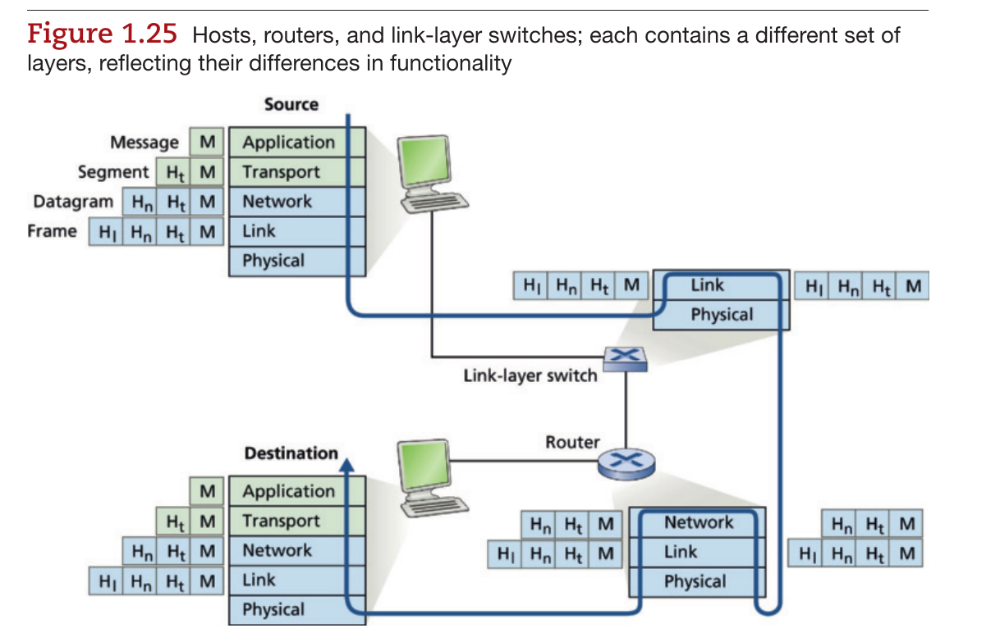
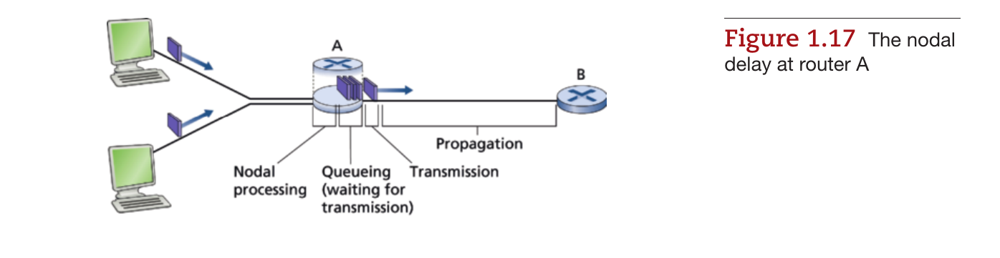
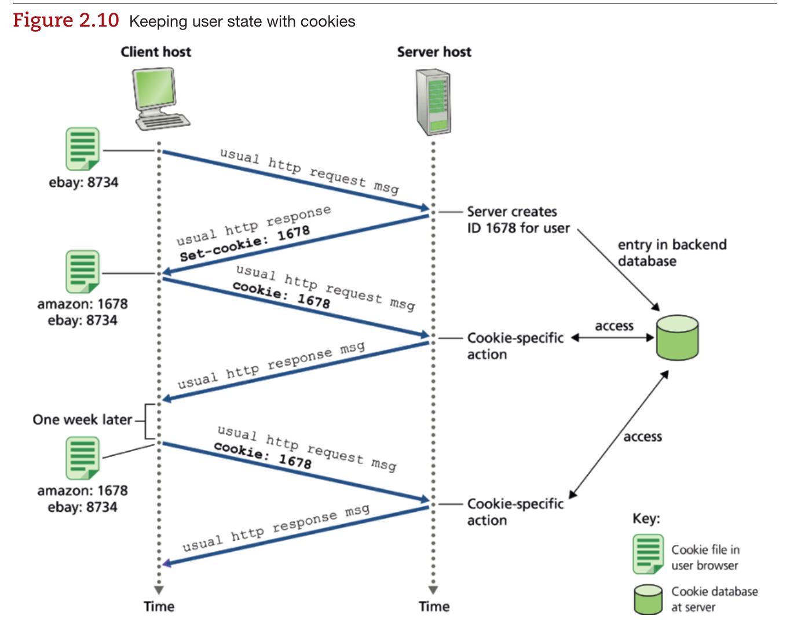
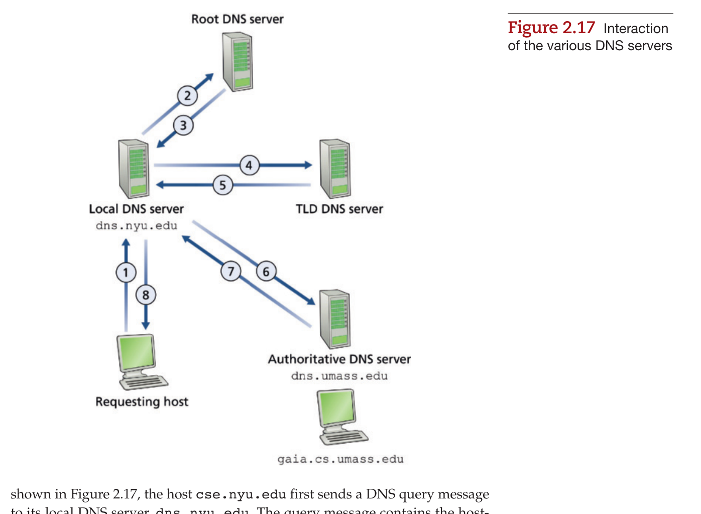
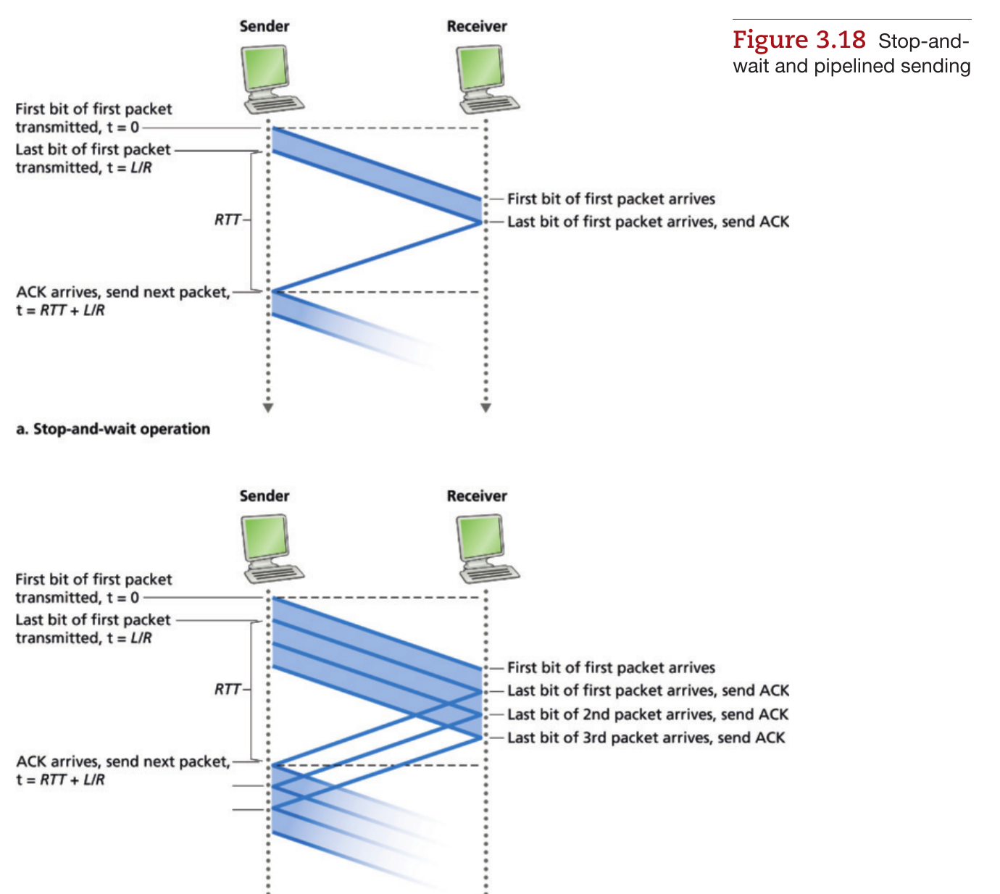
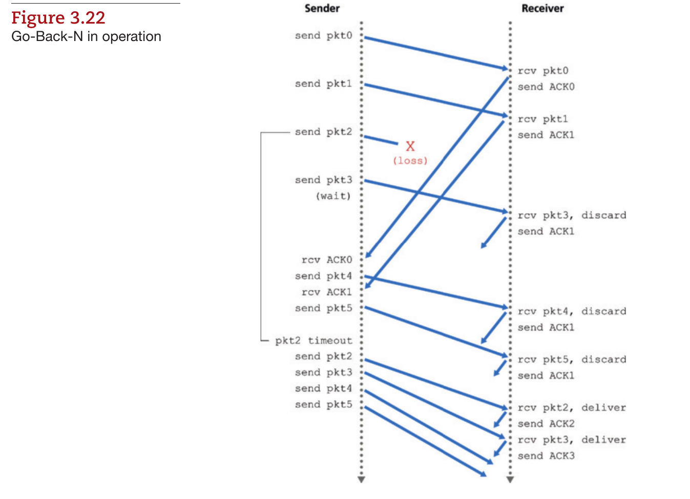
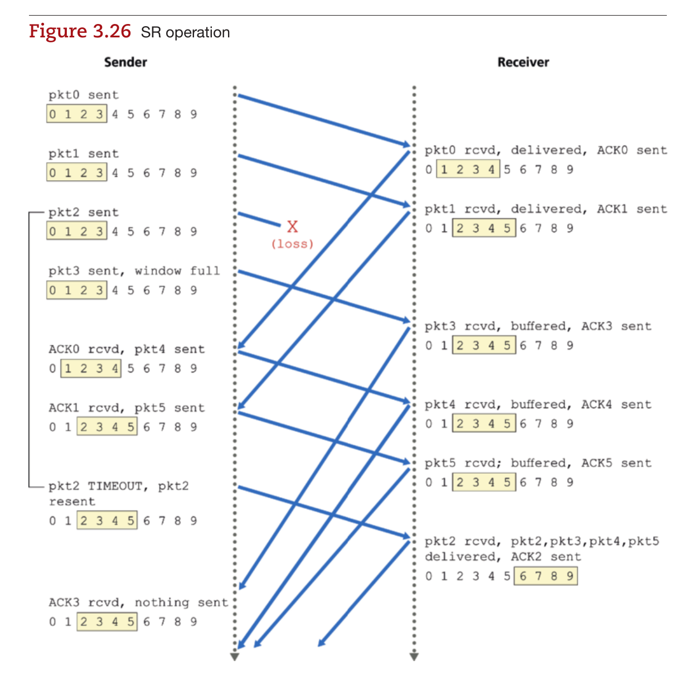
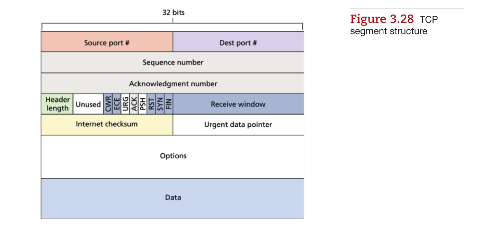
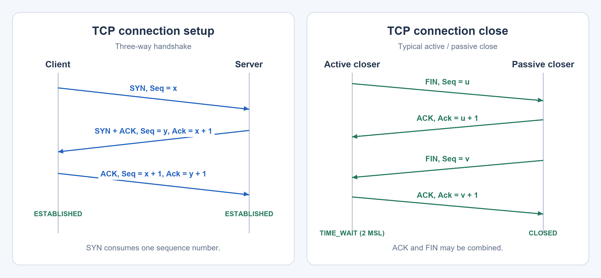
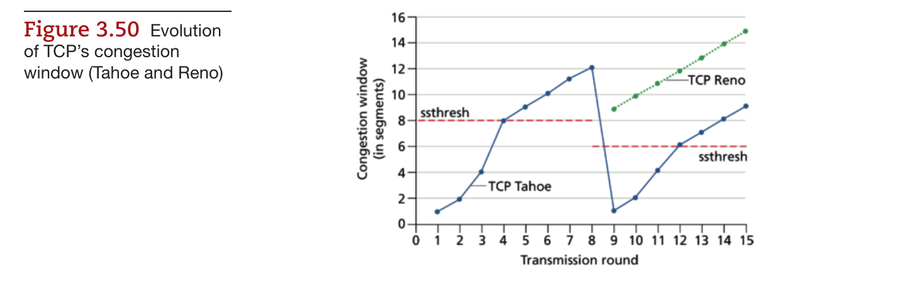

# Introduction

> 主要依据 Chapter 1–3 中文课件及 Kurose、Ross《Computer Networking: A Top-Down Approach》第 9 版整理；P2P 等内容参考第 8 版及课程知识点。教材插图保留原图号，来源为第 9 版；TCP 连接时序图为自绘。

## 网络、协议与分层

+ **Internet**：连接主机、路由器及各种网络的“网络之网”；从应用角度看，是提供进程间通信服务的基础设施。
+ **协议（Protocol）**：规定通信实体交换报文的格式、顺序，以及发送和接收报文时采取的动作。
+ **网络边缘**运行应用；**接入网络**连接主机与边缘路由器；**网络核心**通过路由器转发分组。ISP 通过上游服务、对等互联和 IXP 等方式互连。

|层次|主要功能|典型协议|数据单位|
|---|---|---|---|
|应用层|支持网络应用|HTTP、SMTP、DNS|报文 Message|
|传输层|进程间通信|TCP、UDP|报文段 Segment|
|网络层|主机间分组交付、路由选择|IP|数据报 Datagram|
|链路层|相邻节点间传输|Ethernet、Wi-Fi|帧 Frame|
|物理层|在介质上传输比特|电信号、光信号、无线电|Bit|

**封装**：应用报文 → 加传输层首部 → 加网络层首部 → 加链路层首部／尾部；接收端逐层解封装。路由器主要处理到网络层，链路层交换机主要处理到链路层。

OSI 七层在应用层与传输层之间另设**表示层、会话层**；Internet 协议栈通常由应用自行承担相关功能。



教材图 1.25：源主机逐层封装，目的主机逐层解封装；链路层交换机与路由器处理的层次不同。

### 协议、服务与接口

+ **协议**约束同一层的对等实体如何通信；**服务**描述这一层能为上一层做什么；**接口**是上层调用该服务的方式。
+ 发送方应用看起来是在与对方应用通信，数据实际要先向下经过本机协议栈，再经过网络，到接收方逐层向上传递。
+ 链路层帧只负责一跳。分组经过路由器时，旧帧被解封装，路由器依据 IP 信息转发，再封装成下一跳链路上的新帧；不是把源主机的同一份帧原样送到终点。
+ 分层的优点是模块化、便于替换和定位问题；代价是首部开销及某些跨层功能的重复。

|接入方式|要点|
|---|---|
|DSL|使用电话铜线，不同频段承载语音和数据|
|Cable / HFC|同轴电缆与光纤混合，接入带宽由用户共享|
|FTTH|光纤到户|
|Ethernet / Wi-Fi|常用于局域网接入，分别使用有线／无线介质|
|蜂窝网络|通过基站提供广域移动接入|

物理介质可分为**导引型**与**非导引型**：双绞线、同轴电缆、光纤属于前者，无线电属于后者。光纤衰减低、抗电磁干扰；无线通信还受障碍物、多径和其他发送者干扰。

链路标称速率不等于应用实际吞吐量：首部开销、竞争、重传、瓶颈链路都会占用容量。下载大文件时，应使用路径上的实际瓶颈吞吐量估算完成时间。

## 网络核心：交换、转发与路由

|对比|分组交换 Packet Switching|电路交换 Circuit Switching|
|---|---|---|
|资源分配|按需共享，统计复用|建立连接时预留资源|
|传输|将报文拆分为分组，逐跳转发|沿已建立的电路传输|
|空闲时|其他用户可利用资源|预留资源可能闲置|
|主要特点|适合突发流量，可能排队和丢包|资源可预测，需建立电路|

电路交换中，**FDM** 按频率划分，**TDM** 按周期性时隙划分。

### 统计复用与 ISP 互连

分组交换不提前给每个用户固定份额，而是在用户有数据时共享链路。用户并非总是同时活跃，因此同一条链路可以接入比固定预留更多的用户，代价是忙时可能排队。

课件例子：1 Gbit/s 链路，每个活跃用户需要 100 Mbit/s，每个用户独立地以概率 0.1 活跃。电路交换只能固定容纳 10 个用户；若接入 35 个分组交换用户，令同时活跃人数 $X\sim\mathrm{Binomial}(35,0.1)$：

$$
P(X>10)=\sum_{k=11}^{35}\binom{35}{k}0.1^k0.9^{35-k}\approx0.000424.
$$

这里并没有保证永不拥塞，而是说明超过容量的概率很低。

ISP 不构成简单的严格树形结构：接入 ISP 可购买上游转接服务，不同 ISP 也可直接对等互联，或在 **IXP（Internet Exchange Point）** 交换流量；内容提供商还可建设自己的网络，直接接近用户。

+ **转发（Forwarding）**：把到达某个输入端口的分组送到合适的输出端口，是局部动作。
+ **路由选择（Routing）**：决定源到目的地的路径，是全局过程。
+ **存储转发**：路由器收到完整分组后，才向下一条链路发送。输出链路繁忙则排队，缓冲区满则丢包。

## 时延、丢包与吞吐量

设分组长度为 $L$ bit，链路速率为 $R$ bit/s，链路长度为 $d$，信号传播速度为 $s$：

$$
d_{\mathrm{nodal}}=d_{\mathrm{proc}}+d_{\mathrm{queue}}+d_{\mathrm{trans}}+d_{\mathrm{prop}},
\qquad d_{\mathrm{trans}}=\frac{L}{R},\quad d_{\mathrm{prop}}=\frac{d}{s}.
$$

|时延|含义|取决于什么|
|---|---|---|
|处理时延|检查首部、确定输出链路|处理能力|
|排队时延|等待输出链路|流量强度、突发程度|
|传输时延|将分组的全部比特推入链路|分组长度、链路速率|
|传播时延|比特在介质中传播|距离、传播速度|



教材图 1.17：排队发生在等待输出链路时；传输与传播是相邻但不同的过程。

**传输时延与传播时延不同**：扩大带宽可以减少 $L/R$，不能减少 $d/s$。计算时先统一单位：1 Byte = 8 bit，Mbps 通常表示 $10^6$ bit/s。

平均到达率为 $a$ 个分组/s 时，流量强度 $\rho=La/R$。接近 1 时，平均排队时延通常显著增加；持续输入超过服务能力时，无限缓冲模型中队列不断增长，实际有限缓冲区则会丢包。

常用计算（忽略排队和处理时延）：

+ **单个分组经过 $H$ 条等速链路**：$T=HL/R+\sum_i d_{\mathrm{prop},i}$。
+ **$P$ 个等长分组流水线经过 $H$ 条等速链路**：$T=(P+H-1)L/R+\sum_i d_{\mathrm{prop},i}$。注意 $H$ 是链路数，比中间路由器数多 1。
+ **端到端吞吐量**：受瓶颈限制，约为 $\min(R_1,\ldots,R_H)$。若 $K$ 条连接公平共享瓶颈，则每条约为 $R/K$，还需考虑各自接入链路。
+ **带宽时延积**：$R\times\text{时延}$ 表示相应时间内可容纳的在途比特数；TCP 常用 $R\times RTT$ 估算填满端到端管道需要的数据量。

### 时延计算例子

1500 Byte 的分组经过 100 Mbit/s、长 1000 km 的链路，传播速度取 $2\times10^8$ m/s：

$$
d_{\mathrm{trans}}=\frac{1500\times8}{100\times10^6}=0.12\text{ ms},\qquad
d_{\mathrm{prop}}=\frac{10^6}{2\times10^8}=5\text{ ms}.
$$

从开始发送到最后一比特抵达对端需要 **5.12 ms**。若再提高带宽，传播时延仍是 5 ms；若把分组长度减半，传播时延也不变。

如果前面已有 $q$ 个等长分组等待发送，且链路上没有正在发送的分组，该分组还需排队约 $qL/R$。若有一个分组正在发送，另加它尚未发送完的剩余时间。

**多分组流水线**：3 个等长分组经过 2 条等速链路，每个分组每跳发送需 1 ms，忽略传播时延。第一个分组在 2 ms 时到达，后两个分别在 3、4 ms 时到达，总时间是 4 ms，而不是逐个计算得到的 6 ms。

### 性能指标的区分

|指标|回答的问题|常见单位|
|---|---|---|
|链路容量／速率|链路最多能多快地传比特|bit/s|
|吞吐量|实际交付数据的速率是多少|bit/s|
|时延|一次交付要等多久|ms|
|丢包率|发送分组中有多少未成功到达|比例|
|抖动 Jitter|时延变化有多大|ms|

吞吐量高不等于时延低。大缓冲区可能减少丢包，却让排队时间很长；这类现象常称为 **bufferbloat**。一条路径有足够带宽，也不意味着小请求一定能很快收到响应。

`traceroute` 利用逐步增加的 TTL 探测沿途路由器和往返时延；超时的 `*` 只表示未及时收到回复，不一定表示该跳无法转发。

安全威胁可记为：**嗅探**窃听数据、**伪造**冒充来源、**DoS/DDoS** 消耗资源。常见防护包括加密、身份认证、完整性保护和访问控制。

# 应用层

## 应用架构与传输服务

**C/S** 中服务器持续提供服务，客户端主动联系服务器；**P2P** 中对等方既请求也提供服务。应用进程通过 **socket** 使用传输层，通信端点由 IP 地址与端口号定位。

应用选择传输服务时，主要考虑：**可靠性、吞吐量、时延、安全性**。

### 应用进程与协议

客户端／服务器是**一次通信中的角色**：主动发起联系的一方是客户端，等待联系的一方是服务器。P2P 应用中的一个进程可以同时承担两种角色。

IP 地址定位主机的网络接口，端口定位传输端点；不同主机可以使用相同端口，同一主机上的 TCP 和 UDP 也有各自的端口空间。应用层协议进一步规定报文类型、语法、字段语义及收发规则，例如 HTTP 的请求和响应。

|应用|主要需求|课件中的典型选择|
|---|---|---|
|文件传输、邮件|不能丢数据，对瞬时时延较宽容|可靠传输|
|交互语音／视频|低时延、低抖动，可容忍少量丢失|按实时需求选择传输与恢复机制|
|存储视频流|持续吞吐量、平滑播放|HTTP 流媒体配合播放缓冲|
|即时消息／交易|正确性，并希望尽快响应|可靠传输与应用确认|

应用是“带宽敏感”还是“弹性”的，也会影响选择：前者需要一定速率才能正常工作，后者能利用多少带宽就用多少，只是完成时间不同。

|传输服务|提供什么|不保证什么|
|---|---|---|
|TCP|可靠、有序字节流；流量控制、拥塞控制；面向连接|固定时延、最低吞吐量、默认加密|
|UDP|无连接的数据报交付，开销小，保留报文边界|可靠性、有序性、流量控制、拥塞控制、默认加密|

TLS 在传输服务之上提供加密、完整性保护和身份认证；HTTPS 是通过安全连接传输 HTTP。

## Web 与 HTTP

HTTP 采用请求／响应方式，网页通常由 HTML 基本文件和多个引用对象构成。**HTTP 无状态**表示协议本身不要求记住之前请求的会话状态，应用仍可通过 Cookie 等机制维护状态。

### 连接与版本

|方式|要点|
|---|---|
|非持久 HTTP|每个 TCP 连接通常传一个对象，随后关闭|
|持久 HTTP / HTTP/1.1|复用 TCP 连接，减少重复建连开销|
|HTTP/1.1 流水线|连续发送多个请求，但响应仍按请求顺序返回，可能发生队头阻塞|
|HTTP/2|在同一 TCP 连接上交错传输多个流的帧；TCP 丢包仍可能阻塞所有流|
|HTTP/3|运行在 QUIC 上；QUIC 基于 UDP，提供可靠传输、多流与加密，减少跨流队头阻塞|

RTT 是小报文往返所需时间。课件中的简化模型忽略 DNS、TLS、请求发送和服务器处理时间：

$$
T_{\text{单对象，非持久}}\approx 2RTT+\frac{L}{R}.
$$

其中 1 RTT 建立 TCP 连接，1 RTT 请求并等到响应开始返回。若基本 HTML 另引用 $m$ 个对象，串行非持久下载约需 $2(m+1)RTT$ 加总传输时间；持久但不使用流水线时约需 $(m+2)RTT$。并行连接、缓存和多路复用会改变结果。

### 多对象网页的时间线

以基本 HTML 引用 4 个小图片为例，忽略各对象发送时间，HTML 必须先下载、解析，客户端才知道图片地址：

|模型|时间组成|总时间|
|---|---|---|
|串行非持久|HTML 2 RTT，4 张图片各 2 RTT|10 RTT|
|非持久，4 张图并行|HTML 2 RTT，一轮图片 2 RTT|4 RTT|
|持久、无流水线|建连 1 RTT，HTML 1 RTT，图片各 1 RTT|6 RTT|
|持久、图片请求流水线|建连 1 RTT，HTML 1 RTT，图片一轮 1 RTT|3 RTT|

做题先问：**是否已有连接、是否并行、是否流水线、引用对象何时可知、是否计算 DNS／TLS、对象发送时间能否忽略**。不要直接把所有网页都套成 `2 RTT`。

若需要依次联系 $n$ 个 DNS 服务器，解析时间可记作 $\sum_{i=1}^{n}RTT_i$，再加上 HTTP 时间；若缓存已命中，相关 DNS 查询可以省去。

### 报文与状态码

```http
GET /index.html HTTP/1.1
Host: www.example.com
If-Modified-Since: Tue, 03 Nov 2026 08:00:00 GMT

```

请求格式：**方法、路径、版本 → 首部行 → 空行 → 可选实体**。响应格式：**版本、状态码、短语 → 首部行 → 空行 → 可选实体**。

```http
HTTP/1.1 200 OK
Content-Type: text/html
Content-Length: 17
Connection: keep-alive

<h1>Networks</h1>
```

上面实体为 17 个 ASCII 字节。`Content-Length` 描述实体长度，`Content-Type` 描述内容类型；空行将首部与实体分开。请求行中的路径并不代替 `Host` 首部，多个网站可以共享一个服务器地址。

|项目|含义|
|---|---|
|`GET` / `HEAD`|获取对象／只获取响应首部|
|`POST` / `PUT`|提交数据／创建或替换指定资源|
|`200 OK`|请求成功|
|`301 Moved Permanently`|永久重定向，目标见 `Location`|
|`304 Not Modified`|缓存可继续使用，不传对象实体|
|`400 Bad Request`|请求有误|
|`404 Not Found`|对象不存在|
|`505 HTTP Version Not Supported`|不支持该 HTTP 版本|

状态码可按首位分类：**1xx 信息、2xx 成功、3xx 重定向／缓存验证、4xx 客户端错误、5xx 服务器错误**。状态码表达协议结果，响应实体则可进一步提供页面或错误说明。

### Cookie 与缓存

+ **Cookie**：响应中的 `Set-Cookie` → 浏览器保存 → 后续请求中的 `Cookie`；服务器可结合后端记录识别会话，用于登录、购物车和个性化。
+ **Web 缓存／代理**：面向浏览器充当服务器，面向源站充当客户端。命中可减少访问时延和接入链路流量。
+ **条件 GET**：缓存需验证时发送 `If-Modified-Since` 等条件；未修改返回 `304`，已修改返回 `200` 和新对象。

命中率为 $h$ 时：平均时延约为 $hT_{\mathrm{hit}}+(1-h)T_{\mathrm{miss}}$；若请求率为 $\lambda$、平均对象大小为 $L$，需经过接入链路的对象流量约为 $(1-h)\lambda L$。缓存还会改变排队时延，不能只按命中率线性缩短原来的总时延。



教材图 2.10：浏览器携带标识，服务器通过后端记录关联用户状态。

Cookie 机制可记为四个部分：**响应首部、请求首部、浏览器保存的 Cookie、服务器后端数据库**。Cookie 通常保存标识或少量状态，购物车等完整业务记录可以留在服务器；无状态的 HTTP 请求仍可以承载这个会话标识。

缓存与 Cookie 解决不同的问题：缓存复用内容，Cookie 关联状态。缓存中“存在对象”也不意味着永远可以直接返回，仍需考虑新鲜度与验证条件。

**缓存计算例子**：每秒 10 次请求，平均对象 1 Mbit，接入速率 10 Mbit/s，不使用缓存时对象流量已达到链路容量；命中率 40% 时，经过接入链路的对象流量降为 6 Mbit/s，利用率约为 0.6。若命中耗时 0.01 s、未命中耗时 2 s，则平均为 $0.4\times0.01+0.6\times2=1.204$ s。

### HTTP 队头阻塞

**HTTP/1.1 应用层阻塞**：流水线中的一个大响应在前，小响应即使已经准备好，也需等待前一个响应先返回。HTTP/2 将对象划分成帧并交错发送，使小对象能更早完成。

**TCP 层阻塞**：HTTP/2 的多个流仍共享一个 TCP 字节流。某段 TCP 数据缺失时，后面的字节即使已经到达，也不能越过缺口交给上层，因此多个流一起等待重传。HTTP/3 的独立 QUIC 流主要解决这一层面的跨流等待。

## 电子邮件

```text
发件人用户代理 → 发件服务器 ──SMTP──→ 收件服务器 → 收件人用户代理
                                                           IMAP / POP3 / Web
```

|协议|作用|
|---|---|
|SMTP|推送邮件：提交和服务器间转发；使用 TCP，服务器间传输通常到端口 25|
|IMAP|在服务器上管理、读取、删除邮件及文件夹，适合多设备同步|
|POP3|较简单的邮件取回方式，常见下载并保留／删除模式|
|HTTP(S)|Web 邮箱的浏览器访问界面|

SMTP 交互可记为：`HELO/EHLO → MAIL FROM → RCPT TO → DATA → QUIT`。SMTP 信封中的发件人、收件人与邮件正文首部中的 `From:`、`To:` 是不同层面的信息；MIME 扩展支持附件及多媒体内容。

### 发送与接收的区别

发送方服务器先将邮件放入发送队列，再向收件方服务器发起 SMTP 连接；对方暂时不可达时，可留在队列中稍后重试。收件服务器将邮件保存到邮箱，收件人无需此刻在线。

SMTP 是 **push**，发送方主动推送；IMAP／POP3 是邮件访问，收件人主动读取。邮件用户代理、邮件服务器、传输协议各司其职，不应把“发送到邮件服务器”和“用户读到邮件”看成同一步。

```text
S: 220 mail.example.com
C: HELO sender.example.org
S: 250 Hello
C: MAIL FROM:<alice@example.org>
S: 250 OK
C: RCPT TO:<bob@example.com>
S: 250 OK
C: DATA
S: 354 Start mail input
C: From: alice@example.org
C: To: bob@example.com
C: Subject: Networks
C:
C: Hello!
C: .
S: 250 Message accepted
C: QUIT
```

SMTP 基本报文是文本格式，`DATA` 后发送邮件首部和正文，以单独一行的 `.` 结束。MIME 用 `Content-Type`、内容编码和多部分边界描述图片、附件等内容。

**FTP 补充**：传统 FTP 将控制与数据分开，控制连接通常到 TCP 21，数据通过另一条连接传输，称为带外控制；HTTP 通常在承载请求／响应的连接内组织对象传输。

## DNS

DNS 是**分布式、层次化的域名数据库**，提供域名解析、主机／邮件服务器别名和负载分配。

```text
主机 → 本地 DNS 解析器 → 根服务器 → TLD 服务器 → 权威服务器
```

上图表示解析器逐步查找的顺序；根、TLD 服务器通常给出下一步该联系谁，而不是直接返回最终 IP。

+ **递归查询**：“替我找到最终答案”；**迭代查询**：“我不知道完整答案，但你可以再问它”。常见模式是主机向本地解析器递归查询，解析器向上级服务器迭代查询。
+ **缓存**保存近期记录，TTL 到期后失效；缓存命中可以跳过部分乃至全部层级查询。
+ DNS 传统服务使用端口 **53**，常见查询使用 UDP，也支持 TCP。DNS 属于应用层，域名解析本身也通过网络报文完成。

资源记录形式为 `(Name, Value, Type, TTL)`：

|类型|Name → Value|
|---|---|
|A|主机名 → IPv4 地址|
|AAAA|主机名 → IPv6 地址|
|NS|域名 → 该域的权威名称服务器名|
|CNAME|别名 → 规范主机名|
|MX|邮件域名 → 邮件服务器名|

DNS 报文包含标识和标志，以及**问题、回答、权威、附加信息**四个区域。附加信息可提供相关服务器的地址，减少后续查询。



教材图 2.17：主机先联系本地解析器；解析器依次联系根、TLD、权威服务器，箭头同时标出查询与响应。

### 一次域名解析

假设主机要访问 `www.example.com`，相关缓存均未命中：

1. 主机向本地解析器请求地址。
2. 本地解析器联系根服务器，获得负责 `.com` 的 TLD 服务器信息。
3. 联系 `.com` TLD 服务器，获得 `example.com` 的权威服务器信息。
4. 联系权威服务器，获取 `www.example.com` 的 A／AAAA 记录。
5. 本地解析器缓存结果并答复主机；随后主机才向目标地址建立应用连接。

本地解析器不一定处于域名层次结构的某一固定层，它是用户查询的入口。根服务器也不是“保存所有域名与 IP 的总表”，通常只需知道下一层的委派信息。

### 记录、缓存与委派

例如，`(example.com, ns1.example.com, NS, TTL)` 表示权威服务器名；查询该服务器本身还可能需要 A／AAAA 地址。DNS 附加信息中的 **glue record** 可提供委派所需的地址，避免查找服务器地址时又依赖该服务器造成循环。

`CNAME` 把别名映射到另一个名字，不直接给出 IP；`MX` 给出邮件服务器名，也不等于邮件服务器的地址。负载分配可以让一个主机名对应多个地址，并调整返回地址的顺序。

缓存使 DNS 高效，也意味着变更不是立即处处可见：旧记录在 TTL 内仍可能被使用。TTL 是有效时长，不是“每隔多久自动修改一次记录”。

DNS 标识字段用于将响应与查询匹配，标志字段可表示查询／响应、是否权威、是否请求／支持递归。查询和响应使用相同的总体报文结构，回答不一定只有一条记录。

DNS 安全问题包括伪造回答、缓存投毒和流量放大；DNSSEC 主要提供记录的来源认证与完整性验证，不等于把查询内容加密。

## P2P、流媒体与 CDN

**文件分发**：文件大小为 $F$，分发给 $N$ 个用户；服务器上传速率 $u_s$，用户上传速率 $u_i$，最慢下载速率 $d_{\min}$。理想模型下：

$$
D_{\mathrm{CS}}\geq\max\left(\frac{NF}{u_s},\frac{F}{d_{\min}}\right),\qquad
D_{\mathrm{P2P}}\geq\max\left(\frac{F}{u_s},\frac{F}{d_{\min}},\frac{NF}{u_s+\sum_i u_i}\right).
$$

C/S 的服务器需上传 $N$ 份；P2P 中用户也贡献上传能力。BitTorrent 将文件分块，结合**稀缺块优先**和对等方互惠交换进行分发。

三个 P2P 下界分别来自：**服务器至少上传一份、最慢用户至少下载一份、全体用户总共需要收到 $NF$ 比特**。人数增加也带来更多上传能力，因此 P2P 不必像服务器独自上传那样按人数线性变慢。

例如 $F=1$ Gbit、$N=10$、$u_s=10$ Mbit/s，各用户上传 1 Mbit/s、下载 10 Mbit/s：C/S 下界为 1000 s，P2P 下界为 $\max(100,100,500)=500$ s。这里忽略协议开销，假定网络核心不另设瓶颈。

BitTorrent 中，对等方加入 torrent 后从其他参与者下载不同块；优先下载副本较少的块，有利于块的广泛分布。上传对象主要根据近期交换表现选择，同时偶尔探索新对等方，避免新加入者完全没有交换机会。

+ **流媒体缓冲**：先积累部分视频再播放，以吸收网络抖动；下载长期赶不上播放速率会卡顿。
+ **DASH**：视频分段、多码率编码，清单提供分段地址；客户端根据带宽和缓冲状态逐段选择码率。
+ **CDN**：将内容复制到分布式节点，把用户请求引向合适节点，减少远距离传输与单点瓶颈。可深入接入网部署，也可在较少的大型节点集中部署。

### 从视频编码到分段播放

视频由连续帧组成，编码利用**空间冗余**和**时间冗余**压缩；CBR 使用相对恒定的码率，VBR 随画面复杂程度变化。像素更多、帧率更高或压缩更少，通常需要更多带宽。

播放缓冲把不均匀的网络到达转换为相对均匀的播放输出。设当前缓冲数据为 $B(t)$，下载速率为 $r_{\mathrm{in}}$、播放消耗速率为 $r_{\mathrm{play}}$，则在两者稳定的一小段时间内：

$$
\Delta B\approx(r_{\mathrm{in}}-r_{\mathrm{play}})\Delta t.
$$

下载较慢时缓冲减少；下载较快时缓冲增加。增大初始缓冲可以减少后续卡顿，但会增加开始播放前的等待。

DASH 的关键是**由客户端逐段做选择**：清单给出可用版本，客户端结合当前带宽、缓冲和历史下载情况决定下一段的码率。它不要求整部视频始终使用同一清晰度。

CDN 选节点也不只看地理距离，还需考虑网络路径、节点负载和内容是否已缓存。DNS 可借助别名或返回合适地址把请求引向 CDN；随后客户端从节点请求实际视频分段。

## Socket 操作速查

|对象|典型操作顺序（Python）|
|---|---|
|UDP 服务器|`socket(AF_INET, SOCK_DGRAM) → bind → recvfrom / sendto → close`|
|UDP 客户端|`socket → sendto / recvfrom → close`|
|TCP 服务器|`socket(AF_INET, SOCK_STREAM) → bind → listen → accept`，再用连接 socket 收发|
|TCP 客户端|`socket → connect → sendall / recv → close`|

TCP 的监听 socket 接受新连接，`accept()` 返回独立的连接 socket。TCP 是字节流，**一次 `send` 不对应一次 `recv`**；应用需用长度字段、分隔符等划分消息，`recv()` 返回空字节串表示对端已正常关闭发送方向。

### 最小收发示例

```python
# UDP 客户端：每次发送明确指定目的地址
from socket import AF_INET, SOCK_DGRAM, socket

with socket(AF_INET, SOCK_DGRAM) as sock:
    sock.settimeout(2)
    sock.sendto(b"hello", ("127.0.0.1", 12000))
    data, sender = sock.recvfrom(2048)
```

`recvfrom` 同时返回数据和发送方地址，服务器可据此回复。超时只说明没有按时得到响应，应用可以重试；UDP 本身不会自动补发。

```python
# TCP 客户端：以换行符划分请求与响应
from socket import create_connection

with create_connection(("127.0.0.1", 12000), timeout=2) as sock:
    sock.sendall(b"hello\n")
    with sock.makefile("rb") as stream:
        response = stream.readline()
```

这两个示例分别需要匹配的 UDP 服务和按行回复的 TCP 服务。`sendall` 会处理一次发送未写完的情况；若直接使用 `recv`，仍需循环读取直到收齐应用定义的一条消息。

# 传输层

## 复用、解复用与 UDP

网络层提供**主机间**逻辑通信，传输层进一步提供**进程间**逻辑通信。复用把多个 socket 的数据交给网络层，解复用把到达的数据交给正确的 socket。

|协议|课件中的解复用依据|特点|
|---|---|---|
|UDP|本地目的 IP 与目的端口；重点看目的端口|不同来源的数据报可交给同一个未连接 UDP socket|
|TCP|源 IP、源端口、目的 IP、目的端口四元组|多个客户端访问服务器同一端口，仍可对应不同连接 socket|

UDP 首部共 **8 Byte**：源端口、目的端口、长度、校验和，各 16 bit。长度包含首部和数据。UDP 不握手，不保证可靠和有序；应用可以在其上自行增加所需机制。

**Internet 校验和**：把待校验内容按 16 bit 分组，执行反码加法（最高位进位回卷到最低位），最后逐位取反。接收端连同校验和求和，应得到全 1；否则检测到错误。UDP 校验还覆盖伪首部，可检测部分错误，但不能保证发现所有错误。

### 端口与连接的识别

服务器在 `B:80` 监听，客户端分别为 `A:50000`、`C:50000`，对应 TCP 连接的四元组不同。即使两个客户端源端口相同，也不会因此成为同一连接。

UDP 服务器可以使用一个绑定到固定端口的 socket 接收多个客户端的请求，`recvfrom` 告知每次的来源。UDP 也可以调用 `connect` 设置默认对端，但这不等于像 TCP 那样进行了传输层握手。

端口号为 16 bit。课件常用端口：HTTP 80、HTTPS 443、DNS 53、SMTP 服务器间传输 25、FTP 控制 21、POP3 110、IMAP 143；这些是默认用途，不是所有服务都必须绑定这些端口。

### 校验和例子

以下以十六进制表示两个 16 bit 字，先相加，再把溢出位加回低 16 位：

```text
0xF234 + 0x1234 = 0x10468
回卷进位：0x0468 + 1 = 0x0469
逐位取反：checksum = 0xFB96
接收端校验：0xF234 + 0x1234 + 0xFB96 → 回卷后 0xFFFF
```

校验和不负责纠错或重传。若多个比特变化恰好抵消，仍可能得到相同校验和；可靠传输还需要序号、确认和恢复机制。

## 可靠数据传输：rdt、GBN 与 SR

|协议|信道问题|新增机制|
|---|---|---|
|rdt1.0|完全可靠|直接发送、交付|
|rdt2.0|数据可能损坏|校验和、ACK／NAK、重传；尚不能处理确认损坏|
|rdt2.1|确认也可能损坏|序号，识别重复分组|
|rdt2.2|同上|只用 ACK，重复确认代替 NAK|
|rdt3.0|数据、确认可能丢失|定时器、超时重传；停等方式|

**校验和识别损坏，序号识别重复，ACK 反馈接收情况，定时器处理无响应。** ACK 丢失可能导致重复发送，接收端应重新确认，不能重复向上交付。

停等每次只允许一个未确认分组。忽略 ACK 发送时间、无丢包时，令 $T_t=L/R$：

$$
U_{\mathrm{stop}}=\frac{T_t}{RTT+T_t},\qquad
U_{\mathrm{pipeline}}\approx\min\left(1,\frac{NT_t}{RTT+T_t}\right).
$$

流水线允许多个分组在途；要把发送链路用满，窗口需满足 $N\geq\lceil1+RTT/T_t\rceil$。这里 RTT 按课件模型不包含该数据分组本身的发送时间。

|对比|回退 N 步（GBN）|选择重传（SR）|
|---|---|---|
|发送窗口|最多 $N$ 个未确认分组|最多 $N$ 个窗口内分组|
|接收方|只收下一个期望分组，丢弃乱序分组|缓存接收窗口内的乱序分组|
|确认|累计 ACK：确认编号及之前的全部分组|逐个确认分组|
|定时器|最早未确认分组一个定时器|每个未确认分组分别计时|
|超时重传|最早未确认分组及其后已发送、未确认分组|只重传超时分组|
|序号为 $k$ bit|$N\leq2^k-1$|等大发送／接收窗口时 $N\leq2^{k-1}$|

SR 窗口不能超过序号空间的一半，否则序号回绕后可能混淆“上一轮重传的旧分组”和“这一轮的新分组”。收到窗口前一轮的重复分组时，仍需再次 ACK。



教材图 3.18：停等在每次发送后等待往返，流水线把这段空闲时间用于继续发送其他分组。

### rdt 的状态与异常场景

停等协议的发送方在“等待上层数据”和“等待确认”之间切换。序号只需区分连续两次传输，交替使用 0、1；接收方也记录下一个期望序号。

|事件|发送方／接收方的处理|
|---|---|
|数据损坏|接收方不交付，发 NAK 或最后正确分组的 ACK|
|ACK 损坏|发送方无法确认本次成功，可能重新发送|
|ACK 丢失|发送方等待超时后重发；接收方识别重复并再次确认|
|数据丢失|接收方无从确认，发送方靠超时重传|
|超时过早|原分组可能只是迟到，仍需用序号避免重复交付|

**超时不是“分组一定丢失”的证明**，只是触发恢复的依据。过短造成不必要重传，过长则让真正丢失后的恢复变慢。

例如链路 1 Gbit/s、RTT 30 ms、分组 8000 bit，发送只需 8 μs，停等利用率约为 $8/(30000+8)=0.000267$，即 **0.0267%**。在相同无丢包模型下，要基本填满链路，需要约 3751 个分组的发送窗口。

### 滑动窗口的推进

发送窗口左边界 `base` 是最早尚未确认的序号，`nextseqnum` 是下一个待用序号。只有 `nextseqnum < base + N` 时，才允许发送新的窗口内分组；窗口外的数据继续等待。

收到 ACK 不一定立即推进窗口：GBN 的累计 ACK 可一次跨过多个分组；SR 则只有窗口最左端已确认后，才连续越过后面也已确认的分组。**窗口不是“每收到一个 ACK 就固定右移一格”**。

### GBN：丢一个，后面可能重来



教材图 3.22：窗口为 4，分组 2 丢失；接收方丢弃后续乱序分组，发送方超时后回退重传。

例如发送 0、1、2、3，分组 2 丢失，接收方收到 3 时仍回复 ACK1；若后来又收到 4、5，仍重复 ACK1。发送方等待 2 超时后，从 2 开始重发尚未确认的已发送分组。

如果某个较早的 ACK 丢失，但之后更大的累计 ACK 到达，已确认前缀可以整体前移，不必为了那个单独的 ACK 重发。

### SR：先缓存，等缺口补齐



教材图 3.26：分组 2 丢失后，接收方缓存并确认 3、4、5；分组 2 补到时，再连续交付缓存中的数据。

发送方可以提前知道 3、4、5 已成功，但在 2 未被确认前，左边界仍停在 2。接收端收到窗口外、但属于上一接收窗口的旧分组时，应重新 ACK，这通常意味着先前的确认丢失。

**序号回绕例子**：序号只有 0–3，如果 SR 窗口取 3，接收方交付 0、1、2 后，新的窗口可能包含 3、0、1；此时迟到的旧分组 0 会被误当新分组。因此 2 bit 序号的 SR 等大窗口最多取 2，而 GBN 发送窗口最多取 3。

## TCP：字节流、序号与确认

TCP 提供**全双工、可靠、有序字节流**，有发送／接收缓冲区。**MSS** 是一个 TCP 段可携带的最大数据量，不包含 TCP/IP 首部。

TCP 首部最小 **20 Byte**，主要字段包括：源／目的端口、序号、确认号、首部长度、标志位、接收窗口、校验和和选项。



教材图 3.28：首部中的窗口控制接收能力，序号与确认号管理字节流，选项可扩展协议功能。

|字段|作用|
|---|---|
|源／目的端口|标识两端的传输端点|
|序号／确认号|各 32 bit，分别说明本段位置与期望的下一字节|
|首部长度|以 32 bit 字为单位，帮助定位数据起点|
|ACK|确认号字段是否有效|
|SYN / FIN / RST|建立连接／关闭发送方向／复位连接|
|接收窗口|接收端通告可接收的空间|
|校验和|检测首部与数据中的部分错误|
|选项|如 MSS、窗口扩大、时间戳和 SACK 等|

**MTU 与 MSS**：MTU 是链路允许承载的网络层分组最大长度，MSS 是 TCP 数据最大长度。例如 MTU 1500 Byte、IPv4 首部 20 Byte、TCP 首部 20 Byte 时，常见 MSS 为 1460 Byte；实际首部有选项时需考虑额外开销。

+ **序号 Seq**：本段数据的第一个字节在字节流中的编号。
+ **确认号 Ack**：下一个期望收到的字节编号，即它之前的字节已连续收到。
+ **累计确认**：即使后面的数据已到达，只要前面有缺口，确认号仍停留在缺口处。SACK 选项可补充报告已收到的非连续区间。
+ SYN 和 FIN 各占用一个序号，纯 ACK 不占序号；序号按 $2^{32}$ 回绕。

例如 `Seq=1000`、携带 500 Byte，按序收到后确认 `Ack=1500`；若接下来收到 `Seq=2000` 而缺少 `1500–1999`，累计确认仍为 `1500`。

### 双向字节流与累计 ACK

全双工连接的两个方向有**独立的序号空间**。A 发给 B 的确认号描述 B→A 字节流的接收情况，不是对 A 自己发送数据的确认。一个段可以同时携带本方向的数据和对反方向的 ACK，称为捎带确认。

|到达接收方的数据|接收情况|返回累计确认|
|---|---|---|
|`Seq=1000, Len=500`|连续收到 1000–1499|`Ack=1500`|
|`Seq=2000, Len=500`|1500–1999 缺失，缓存后段|仍为 `Ack=1500`|
|`Seq=1500, Len=500`|缺口补齐，已有后段可连续交付|`Ack=2500`|

收到 `Ack=2500` 表示此前所有字节已连续收到，不意味着某一个 TCP 段长度为 2500，也不意味着接收应用已经读取了这些数据。

### RTT 估计与重传

课件使用 EWMA 估计 RTT：

$$
\begin{aligned}
\mathrm{EstimatedRTT}&\leftarrow(1-\alpha)\mathrm{EstimatedRTT}+\alpha\,\mathrm{SampleRTT},\\
\mathrm{DevRTT}&\leftarrow(1-\beta)\mathrm{DevRTT}+\beta|\mathrm{SampleRTT}-\mathrm{EstimatedRTT}|,\\
\mathrm{TimeoutInterval}&=\mathrm{EstimatedRTT}+4\,\mathrm{DevRTT},
\end{aligned}
\qquad \alpha=\frac18,\quad\beta=\frac14.
$$

+ **超时重传**：重传最早未确认段；连续超时会扩大超时间隔，通常采用指数退避。
+ **快速重传**：收到 3 个重复 ACK 时，在超时前重传最早缺失段。是“原 ACK 之后再收到 3 个相同 ACK”。
+ 重传段的 ACK 难以对应具体哪次发送，通常不据此测量 SampleRTT。

TCP 结合累计确认、超时重传和接收端缓存等机制，不能简单等同于纯 GBN 或纯 SR。

### ACK 丢失与重复 ACK

若发送方先后发送 `Seq=1000, Len=500` 和 `Seq=1500, Len=500`，接收端的 ACK1500 丢失、ACK2000 到达，后者已累计覆盖前一个段，不必重传第一个段。

相反，若第一个段丢失，后面的段持续到达，接收端会重复返回 ACK1000。重复 ACK 暗示后续数据仍在到达，但存在缺口，发送方可在超时前进行快速重传。

课件中的 ACK 生成规则可归纳为：按序段可以短暂延迟确认，第二个按序段到达时及时确认；乱序段到达时立即回复指向缺口的重复 ACK；补齐缺口的段到达时立即更新确认。

**RTT 更新例子**：旧 EstimatedRTT 为 100 ms，新 SampleRTT 为 140 ms，取 $\alpha=1/8$，更新后估计为 105 ms。若旧 DevRTT 为 10 ms，并按课件先更新估计再求偏差，则新 DevRTT 为 $0.75\times10+0.25\times35=16.25$ ms，超时间隔为 170 ms。

## TCP 连接管理



三次握手：`SYN(x) → SYN(y)+ACK(x+1) → ACK(y+1)`。双方交换初始序号并确认彼此的接收能力，避免仅凭迟到的旧连接请求就错误建立连接；第三次可携带数据。

关闭时，两个方向分别发送 FIN、由对方确认，因此常见四段交换；ACK 与 FIN 可合并，关闭也可同时发起。

+ 主动关闭方典型状态：`FIN_WAIT_1 → FIN_WAIT_2 → TIME_WAIT → CLOSED`。
+ 被动关闭方典型状态：`CLOSE_WAIT → LAST_ACK → CLOSED`。
+ **TIME_WAIT** 通常持续 2 MSL：保留重发最后 ACK 的机会，并让旧连接的报文在网络中消失。

### 为什么建立连接要三次？

只收到客户端的 SYN，服务器知道“有人想建立连接”；客户端收到 SYN+ACK 后，知道服务器收到了自己的初始序号，也知道服务器的初始序号。最后的 ACK 再让服务器知道客户端已收到自己的信息。旧 SYN 迟到时，仅凭两次交换容易让服务器误以为客户端仍要建立连接。

三次握手交换的是**连接意愿与初始序号**，不是每发一段数据都握手。服务器通常先处于 LISTEN，客户端发 SYN 后进入 SYN_SENT，服务器回 SYN+ACK 后进入 SYN_RCVD，最终进入 ESTABLISHED。

### 半关闭与最后一个 ACK

TCP 的两个方向分别关闭。A 发 FIN 后，表示 A 不再发送新数据，但 B 仍可以继续发送，直到 B 也发 FIN；A 的 `FIN_WAIT_2` 与 B 的 `CLOSE_WAIT` 就可能出现在这段时间。

若最后 ACK 丢失，被动关闭方会重发 FIN，处于 TIME_WAIT 的主动关闭方可以再次 ACK。四段关闭是一种常见时间线，若对方已准备好关闭，可以把 ACK 与自己的 FIN 合并。

FIN 用于正常结束，RST 则复位连接；二者不应混淆成同一种关闭流程。

## 流量控制与拥塞控制

|对比|流量控制 Flow Control|拥塞控制 Congestion Control|
|---|---|---|
|保护对象|接收端缓冲区|网络链路和路由器缓冲区|
|限制依据|接收窗口 `rwnd`|拥塞窗口 `cwnd`|
|反馈来源|接收端通告剩余空间|丢包、时延或显式拥塞通知等|

接收缓冲区大小为 $B$ 时，课件的简化模型：

$$
rwnd=B-(\mathrm{LastByteRcvd}-\mathrm{LastByteRead}),\qquad
\mathrm{LastByteSent}-\mathrm{LastByteAcked}\leq\min(rwnd,cwnd).
$$

窗口限制的是**已发送但未确认的在途字节数**。窗口受限时，发送速率约为 $\min(rwnd,cwnd)/RTT$。接收方通告零窗口后，发送方可通过零窗口探测获知窗口重新打开。

### 窗口计算例子

假设接收缓冲区为 10000 Byte，已收到但应用尚未读取的数据为 6000 Byte，则通告 `rwnd=4000`。若发送方 `cwnd=8000`，则在途数据最多受限于 4000 Byte；如果当前已有 2500 Byte 未确认，可再发送约 1500 Byte。

应用读走缓冲中的数据后，`rwnd` 可以扩大；网络变得拥塞时，`cwnd` 可能缩小。两个窗口由不同原因变化，最终取更严格的限制。

拥塞会增加排队、丢包和重传；下游丢掉分组，还会浪费该分组已消耗的上游资源。控制方法可分为**端到端推断**和 **ECN 等网络辅助反馈**。

### 经典 TCP：慢启动、拥塞避免、快速恢复

以下按课件的 Reno 模型，初始窗口取 1 MSS，忽略具体实现的初始窗口差异：

|阶段／事件|窗口变化|
|---|---|
|慢启动（Slow Start）|每个新 ACK 增加约 1 MSS，约每 RTT 翻倍|
|达到 `ssthresh`|转为拥塞避免|
|拥塞避免（Congestion Avoidance）|每 RTT 约增加 1 MSS；每新 ACK 增加约 $MSS^2/cwnd$|
|3 个重复 ACK|快速重传；`ssthresh = 旧 cwnd / 2`，`cwnd = ssthresh + 3 MSS`，进入快速恢复|
|快速恢复收到额外重复 ACK|`cwnd` 增加 1 MSS|
|快速恢复收到覆盖重传缺口的新 ACK|`cwnd = ssthresh`，进入拥塞避免|
|超时|`ssthresh = 旧 cwnd / 2`，`cwnd = 1 MSS`，重新慢启动|

**AIMD**：拥塞避免时加性增大，检测到拥塞时乘性减小，形成锯齿状窗口。Tahoe 在 3 个重复 ACK 后也回到 1 MSS；Reno 用快速恢复避免完全重新慢启动。

忽略慢启动，若窗口在 $W/2$ 到 $W$ 间线性变化、RTT 近似不变，则：

$$
\text{平均吞吐量}\approx\frac{3W}{4RTT}.
$$

这里 $W$ 以 Byte 计，结果为 Byte/s；若要求 bit/s，需乘 8。



教材图 3.50：先指数增长，再线性增长；同样收到 3 个重复 ACK，Tahoe 与 Reno 的回退方式不同。

### 窗口曲线怎么读

按“每轮约一个 RTT、每段都被及时确认”的简化模型，初始 `cwnd=1 MSS`、`ssthresh=8 MSS`：窗口依次约为 **1、2、4、8、9、10、11……**。前半段是慢启动，达到阈值后改为每轮增加 1 MSS。

若在窗口 12 MSS 时收到 3 个重复 ACK，Reno 将 `ssthresh` 设为 6 MSS，快速恢复阶段临时取 9 MSS；缺口得到确认后回到约 6 MSS，并继续拥塞避免。若改为超时，则窗口降到 1 MSS，先慢启动到阈值附近。

看到曲线时，先区分**每个 ACK 的增长**和**每 RTT 的增长**。慢启动是每个新 ACK 加约 1 MSS，累计起来每 RTT 近似翻倍；拥塞避免才是每 RTT 加约 1 MSS。

### 丢包率与长期吞吐量

在 Reno 的理想锯齿模型中，窗口从 $W/2$ 线性增到 $W$，每周期约传输 $3W^2/8$ 个段（此处 $W$ 以 MSS 个数计）。若每周期约发生一次丢包，丢包率 $p\approx8/(3W^2)$，可得常用近似：

$$
\mathrm{Throughput}\approx\frac{1.22\,MSS}{RTT\sqrt p}.
$$

MSS 以 Byte 计时，结果为 Byte/s。它说明在其他条件相同的简化模型中，RTT 越大、丢包率越高，长期吞吐量越低；该公式不描述慢启动、频繁超时或接收窗口限制等阶段。

### CUBIC、BBR 与公平性

+ **CUBIC**：以距上次拥塞事件的时间为自变量，用立方曲线调整窗口；远离旧最大窗口时增长较快，接近时放慢探测。
+ **BBR**：估计瓶颈带宽和最小 RTT，按带宽时延积控制在途数据并进行速率探测，目标是让管道充分利用而不过度排队。
+ **公平性**：相似条件下，$K$ 条 TCP 流共享容量 $R$ 的瓶颈，目标是各约 $R/K$。公平的单位是连接；一个应用建立多个连接可能占到更多带宽。
+ UDP 自身没有拥塞控制；基于 UDP 的应用或上层协议仍可实现拥塞控制，QUIC 即是一例。

ECN 让路由器在支持的分组中标记拥塞，接收端反馈给发送端，使其可以在大量丢包前减速。它是网络辅助反馈，数据不需要为了报告拥塞而先被丢弃。

BBR 的核心估计为 $\mathrm{BDP}\approx\mathrm{BtlBw}\times\mathrm{RTT}_{\min}$。当在途数据不足时，增加数据能提高吞吐量；瓶颈已满后，继续增加主要让队列与 RTT 增长。BBR 因此周期性探测带宽并排空部分队列，以更新模型。

## QUIC

QUIC 基于 UDP 实现连接管理、可靠传输、拥塞控制和加密；将安全协商与传输握手结合，通常 1 RTT 建立新连接，并在一条连接中承载多个流。

**一个流的数据缺失不会因为共享 TCP 的有序字节流而阻止其他流交付**；丢包仍可能影响共享连接的发送速率，同一个流内部也仍需等待缺失数据。HTTP/3 使用 QUIC，而不是“直接靠不可靠 UDP 传网页”。

QUIC 的流可分别进行可靠交付，连接仍可统一进行拥塞控制；流 ID 用于识别同一连接中的不同逻辑数据流。这与“每个对象都新建一条 TCP 连接”是不同的组织方式。
