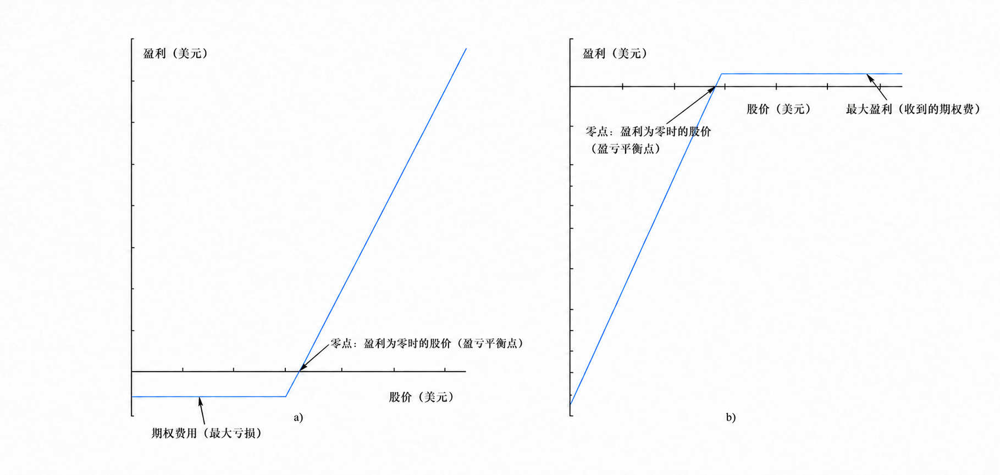

> 思考再三，还是决定整理下这门课的内容（不然感觉要挂科……

# 金融工程概述
金融工程的基本目的：
+ 降低风险——减小损失
+ 发现市场缺陷——寻找套利机会
+ 产品创新——寻找新价值

金融工程的核心问题是定价，常用方法包括：
+ 现金流贴现估值
+ 风险/收益均衡定价
+ 无套利定价【本课程重点】

金融工程的正式定义：综合采用各种工程技术方法设计、开发与实施创新型金融产品（包括金融工具和金融服务），创造性解决各种金融问题。
+ 主要使用的金融工具/产品：期权、期货、远期、互换等金融衍生品
+ 金融工程的研究范围：风险管理理论（风险度量与规避）、金融衍生产品定价、新型金融产品与金融手段开发

## 金融衍生产品简述
金融衍生产品（derviatives）是依附于某种基础资产（也成为标的，往往指其价格）派生出来的产品，也称为金融衍生工具/金融产品/金融工具。  
金融衍生产品的分类如下：
+ 按形态分：远期（forwards）、期货（futures）、期权（options）、互换（swaps）
+ 按标的资产：股权类衍生品、货币衍生品、利率衍生品、商品衍生品等
+ 按权责：风险收益对称/不对称
+ 按复杂程度：普通型/结构性金融衍生品

金融衍生产品对经济环境中的风险转移起到了至关重要的作用（因为已经敲定了买卖价格）。实际上，很多金融产品都有内嵌衍生品的特征。金融衍生产品的主要形态包括：
1. 远期合约：在将来某一指定时刻以约定价格买入或卖出某一产品的合约。【典型例子：外汇远期合约】
    + 交易发生在场外交易市场（OTC）的金融机构之间或金融机构与客户间。场外交易市场的规模远远大于交易所市场，其优点是灵活，合约内容不受交易所的限制；缺点则是存在信用风险、信息不灵通、转手不易、交割麻烦等问题。
    + 不同到期日的远期合约价格可能会有不同
    + 称同意买入资产的一方为长头寸或多头，称同意卖出资产的一方为短头寸或空头。
    + 在合约到期时：
        + 对于长头寸方，合约约定长头寸方必须以$K$的价格买入价值为$S_T$的资产，每一单位的合约收益为$S_T-K$；
        + 对于远期合约的短头寸方，合约所带来的收益为$K-S_T$表中两项收益可正可负。由于进入远期合约的费用为0，所以合约的收益也就是交易员所有的盈利或亏损。
2. 期货合约：可看作标准化的远期，需要在场内交易
    + 期货交易的标的资产涉及商品资产和金融资产
    + 现货价格（立即交割的价格）通常不等于期货价格（将来某一时刻交割的价格）
    + 传统上，期货合约的交易是在交易所中通过公开喊价系统进行的，而如今交易所已逐渐采用电子交易来代替公开喊价系统
3. 期权合约：赋予持有者在给定日期或该日期之前的任意时间以约定的价格执行买入或卖出某种资产的权力（需要支付期权费用）
    + 期权可以在交易所和场外市场进行交易
    + 期权的买方只有权力，而期权的卖方有绝对的义务
    + 期权合约按行权方向可分为**看涨期权**（持有者有权在将来某一确定时间以某一确定价格买入某种资产）和**看跌期权**（持有者有权在将来某一确定时间以某一确定价格卖出某种资产）；按行权时间可分为**美式期权**（可以在到期前的任何时间行使权利）和**欧式期权**（只能在到期日这一特定日期行使权利）

    在一份期权产品中会有行权价格（也称执行价格/敲定价格），以及到期日（最晚行权时间）。一般而言，执行价格增加时，看涨期权的价格会下降，看跌期权的价格会上升；而期权期限增加时，期权价格则都会上升。
    + 看涨期权与看跌期权净盈利与股价的关系示意图如下：

三种合约综合比较：
+ 期权赋予期权所有者某种权力，持有者也可以选择不执行该权力；远期及期货合约则必须执行
+ 期权必须支付期权费，而远期或期货交易不需要任何费用（保证金除外）
+ 交易场所不同（远期：场外交易；期货：交易所；期权：交易所/场外交易）
## 交易员的种类
+ 对冲者：采用期货、远期、期权等行生产品合约来减少自身面临的由于市场变化而产生的风险
    + 对冲可以减小风险，但对冲后的实际效果（以盈利来衡量）并不一定比不对冲的实际效果好。
    + 远期/期货对冲与期权对冲比较：远期/期货合约通过设定买入及卖出标的资产价格来对冲；期权合约为投资者所面临的未来市场不利的价格变化提供保护，同时又允许投资者在价格向有利方面变化时而受益
+ 投机者：利用对一些产品今后市场的变化走向下注
    + 期权会给投资者提供杠杆效应，对于一个给定的投资，期权会放大其最终的效果，好的收益会更好，差的收益可能使投资者丧失全部投资。
    + 对于投机者所取得的杠杆效应，期货和期权比较相似，重要区别在于：
        + 采用期货时，投机者潜在的损失和收益都很大
        + 采用期权，无论市场多糟，投机者的损失都不会超过
所付出的期权费用
+ 套利者：采用两个或更多相互抵消的交易锁定盈利【在下面会有详细分析】
## 补充：利率的计量
年利率为$r$, 当前时刻数量为$A$的货币在$n$年后的终值
+ 单利: $A(1 + rn)$
+ 复利（每年复利1次）: $A(1 + r)^n$
+ 复利（每年复利$m$次，此时为名义利率）: $A(1 + \frac{r}{m})^{mn}$
  + $m = 1$, 与年利率等值
+ 连续复利: $Ae^{rn}$, 也称为利率强度、利息力
+ 与连续复利$R_c$等价的每年$m$次复利利率$R_m$

有效年利率$R_1$、名义年利率$R_m$与连续利率$R_c$的相互转换：
$$
\begin{aligned}
1 + R_1 &= \left( 1 + \frac{R_m}{m} \right)^m = e^{R_c} \Longrightarrow 
\begin{cases}
\displaystyle R_m = m \left[ (1 + R_1)^{1/m} - 1 \right] = m \left( e^{R_c/m} - 1 \right) \\
\displaystyle R_c = m \ln \left( 1 + \frac{R_m}{m} \right)
\end{cases}
\end{aligned}
$$
# 无套利定价原理
无套利分析理论与1958年由莫迪利安尼和米勒在研究企业资本结构和企业价值的关系（即资本结构的MM定理）时提出。
+ MM定理指出，在一个完全/有效市场，融资方式（发行股票和债券）与公司价值无关。
    > 这里的完全/有效市场是指投资者可以无障碍自由交易，且资产价格能够及时、充分地反映市场中可获得的信息。
+ 无套利定价原理属于金融资产（特别是衍生产品）的定价方法，也是定价理论中最基本的原理之一。
+ （无风险）套利的理论定义：一个能产生无风险盈利的交易策略
    + 在实际市场中，指预期只需承受很低风险的盈利策略（即风险套利）
    + （无风险）套利机会的定义：不考虑违约与交易费用，买卖交易时间与买卖交货时间分别完全相同【简单而言就是以低价买入某资产的同时，能够立即以高价卖出】
    + 金融市场的独特性极大地减弱了套利障碍，这是因为：
        + 交易市场的专业化、电子化，金融产品无形化（电子化、数字化）
        + 卖空机制增加了套利机会，且金融产品时间和空间上的多样性使套利更便捷
    + 然而，现实中仍然难以寻找套利机会，因为：
        + 难于寻找相同时间恰好低买高卖同一标的资产的两方
        + 需考虑交易成本/费用：税收、佣金、信息成本、空间成本、时间成本和风险
+ 无套利定价原理的含义：在有效市场中，市场价格必然由于套利行为作出相应的调整，重新回到均衡状态。这种无套利均衡被用于确定金融产品在市场的合理价格，也就是使得市场不存在无风险套利机会的价格。
+ 无风险套利机会存在的等价条件：
    + 存在两个不同的资产组合，它们的未来损益（现金流）相同，但成本不同
    + 存在两个成本相同的资产组合，组合一在所有的可能状态下的损益都不低于组合二，并且至少存在一种状态，在此状态下组合一的损益大于组合二
    + 一个组合成本为0，但在所有状态下损益都不小于0，并且至少存在一种状态使得该组合的损益大于0
+ 由上述等价条件得到的等价推论：
    + 同损益同价格：如果两种证券具有相同的损益，则这两种证券具有相同的价格（也称为“一价定律”）
    + 静态组合复制定价：如果一个资产组合的损益等同于一个证券，那么这个资产组合的价格等于证券的价格（“复制组合”）
    + 动态组合复制定价：若一个自融资交易策略和一证券损益相同，那么该证券价格等于自融资策略的成本（动态套期保值策略）
        + 动态复制与静态复制的主要区别：静态复制在买入固定数量资产后就一直持有到期；而动态复制需要随着市场变化，不断调整投资组合中的资产数量。
        + 自融资策略含义：投资策略建立以后，每一次调整持仓所需的资金，都来自策略内部的资产买卖或者现金账户，不需要投资者额外注入资金，也不允许从组合中无偿取走资金。
## 确定状态下无套利定价原理的应用
理想状态：
+ 市场无摩擦（不存在交易成本）
    + 企业不缴纳所得税
    + 发行证券不需要交易成本
    + 公正的信息披露
    + 与企业有关者可以无成本地解决彼此的利益冲突问题
+ 不考虑违约风险（负债的收益率是无风险收益率）

实际市场一般存在摩擦（交易成本），因此构造的套利策略获得的盈利可能低于交易成本。此时无套利定价原理不能给出确切价格，但可以给出金融产品的价格区间（价格的上、下限）。
+ 价格下限：理论价格 - 最小总交易成本
+ 价格上限：理论价格 + 最小总交易成本
## 不确定状态下无套利定价原理的应用
1. 单步二叉树模型   
    设股票当前价格为$S_0$，期限为$T$的股票期权当前价格为$f$。假设$T$时刻股票价格可能上涨为$S_0u$（相应的期权价值为$f_u$），或下跌至$S_0d$（相应的期权价值为$f_d$）。无风险年利率为$r$（连续复利）。
    - 构造无风险证券组合：$\Delta$股股票多头，1 份期权空头【$\Delta$也称为对冲比率】
    - 无风险组合：$S_0u\Delta - f_u = S_0d\Delta - f_d \Longrightarrow \Delta = \dfrac{f_u-f_d}{S_0u-S_0d}$
    - 根据构造组合的成本 = 组合价值的贴现，得到
    $$
    \begin{aligned}
    &S_0\Delta - f = (S_0u\Delta - f_u)e^{-rT} = (S_0d\Delta - f_d)e^{-rT}\\
    \Longrightarrow &f = e^{-rT}[pf_u + (1-p)f_d], \quad p = \frac{e^{rT}-d}{u-d}
    \end{aligned}
    $$
2. 两步二叉树模型   
    一般在动态组合复制定价中使用，核心仍然是用风险中性原理从后向前反推定价（拆成多个单步二叉树模型计算）
# 远期外汇与外汇期货
> FX，简单！

什么是外汇？简单而言就是以外国货币表示的货币、票据和有价债券。具体而言：
+ 广义：包括以外国货币支付的外钞、银行存款、各类票据、外国国债、外国公司债券、外国公司股票等一切外币债权债务
+ 狭义：外国货币表示的货币

在介绍外汇远期与期货之前，需要简单介绍期货和远期市场的运作机制：
## 期货市场运作机制
首先给出期货交易的主要术语：
+ 开仓：交易者新买入或卖出一定数量的期货合约
+ 持仓：交易者持有期货合约的过程，持有的头寸称为未平仓头寸，分为多头头寸与空头头寸
+ 平仓：交易者买入或卖出与其所持合约品种、数量与交割月份相同但交易相反的合约，结束期货交易的行为

期货合约的交易流程：
1. 开户    
    + 期货交易必须集中在交易所内进行，在场内操作交易的只能是交易所会员（期货经纪公司，自营会员）
    + 普通投资者在进入期货市场交易之前，应首先选择一个具备合法代理资格、信誉好、资金安全、运作规范和收费比较合理的期货经纪公司会员，自营会员没有代理资格。
    + 开户的主要流程：实名认证$\to$风险揭示、签署合同$\to$缴纳保证金
2. 下单  
    下单指令类型主要包括下面三种：
    1. 市价指令（market order）：最常见的一种指令.仅指明要买卖期货的种类与数量，并不指明具体价位，以市场上可以得到的最好价格马上进行交易
    2. 限价指令（limit order）：限定一个交易价格，指令必须按照规定的或者更好的价格执行
    3. 止损指令（stop-loss order）：为了避免大的损失，预设一个最大亏损的价位限度，当价格达到这一水平时，指令按照市价执行
3. 竞价   
4. 结算    
    期货结算制度包括：保证金与每日结算制度、T+0制度、双向交易制度、涨跌停板制度、持仓限额制度、大户报告制度等
5. 平仓/交割  
    期货交易的终止方式包括在最后交易日前进行平仓或者持有到期进行交割，其中平仓是主要方式。

期货合约的内容：资产品种、合约的规模、交割地点、交割月份、报价、价格和头寸的限额、交割资产的备选方案（可选）、保证金、手续费等。
+ 随着期货合约交割月份的逼近，期货价格会逐渐收敛到标的资产的现货价格，在到达交割日时，期货价格会等于或非常接近现货价格。
### 保证金
+ 保证金账户运作：
    + 设置保证金的目的：在交易所组织交易中避免违约的产生
    + 每日（无负债）结算【逐日盯市】
    + 初始保证金：最初开仓时必须存入的资金量
    + 维持保证金：一般为初始保证金的75%
        + 当某一交易日保证金账户内资金低于维持保证金时，投资者会收到保证金催付通知，需要在下一个交易日将保证金账户内资金补足到初始保证金的水平。【即追加保证金】
    
    保证金的报价方式有两种：固定金额/固定比率。【实际上固定比率的倒数就是交易的杠杆倍数】
+ 保证金的现金流动：
    + 期货价格下跌时：多头的保证金（经过层层中间商，下同）流向空头
    + 期货价格上涨时：空头的保证金流向多头

    中间商包括：
    + 清算中心：期货交易的媒介（交易所的附属机构），保证交易双方履行合约
    + 结算会员：经纪人通过会员来开展业务

    清算中心的主要任务：记录每天的交易，计算每个会员的净头寸
    + 结算中心要求其会员提供的初始保证金
    + 结算中心会员的保证金账户的余额在每一交易日结束时按其盈亏做出调整（与投资者保证金账户类似），对于结算中心的会员只有初始保证金的要求，没有维持保证金要求
    + 保证金按未平仓合约的净持仓来计算
+ 场外市场（远期合约）的保证金：由于场外市场具有信用风险，因此它主动/被动地借用了交易所采用的一些机制：例如双边结算场外市场的抵押品协议。
### 期货市场报价
+ 结算价格：用于计算每天合约的盈亏以及所需保证金的数额
+ 未平仓合约数量：正在交易的合约数量的总和

期货价格规律：
+ 正常市场：交割价格随期限增加而上升
+ 反向市场：价格为合约期限的递减函数
+ 混合型市场：期货价格曲线呈现非单调的波峰或波谷

### 期货（实物）交割
+ 第一交割通知日：可以向交易所发出交割意向的第一天
+ 最后交割通知日：可以向交易所发出交割意向的最后一天
+ 最后交易日：通常是最后交割通知日的几天前

在现实中一般不会进行实物交割，而往往会采用现金结算（即平仓）。
## 期货与远期合约区别
| 远期合约 | 期货合约 |
| :--- | :--- |
| 交易双方的私下合约 | 交易所内的标准合约 |
| 非标准化 | 标准化 |
| 通常只有单一交割日 | 有一系列的交割日 |
| 合约到期时结算 | 每日结算 |
| 通常发生实物/现金交割 | 合约通常在到期前被平仓 |
| 有信用风险 | 几乎没有信用风险 |

在收益上，远期的全部损益均在到期时实现，而期货的损益每天被实现，收益分散在合约的每一天。总体来看，将期货的每日损失和收益相抵后，总收益与远期相同。

## 外汇报价
汇率的报价主要有下面两种方法：
+ 直接报价法/价格报价法：以本国货币来表示一个单位的外国货币的价格
+ 间接报价法/数量报价法：一个单位的本国货币折合成多少外国货币
    + 目前英镑、欧元、澳元和新西兰元采用间接报价法

在期货中有美元时，期货的报价是一个外币单位所对应的美元/美分数量；  
远期报价永远同现货市场报价一样。对于英镑、欧元、澳元、新西兰元，远期报价以1外币所对应的美元价格为单位，而其他货币的远期报价以1美元兑换的外币数量为单位。
+ 银行一般会采用双向报价，即买入价格（bid rate）与卖出价格（offer rate）。卖出价一定比买入价高，二者差价就是银行的利润
+ 另外，银行的现钞与现汇的买入价不同，外汇管理方法也不同。【银行现钞的买入价通常远低于现汇的买入价】
## 远期外汇合约
定义：交易双方约定在未来某一指定日期，双方按照合约签订时约定的汇率和金额，以一种货币交换另一种货币的协议
+ 远期汇率：两种货币在未来某日期交割的买卖价格
+ 即期汇率：当日交易两日后交割的外汇价格

远期外汇的作用：规避汇率上升或下跌的风险

远期汇率的计算：
+ 设目前的即期汇率为$S$（单位是本国货币/外币），外币年利率$i_b$，本国货币年利率$i_q$，二者对应一年天数为$B_b$与$B_q$，那么$D$天后的远期汇率$F$可由无风险套利原理计算：
    $$
    F=S\frac{1+\frac{D}{B_q}i_q}{1+\frac{D}{B_b}i_b}
    $$
    > 直观理解：用本币直接做无风险投资与把本币换成外币、做外币无风险投资、同时用远期合约锁定未来换回本币的汇率，这两种策略的无风险收益必须相等。
+ 远期外汇合约报价主要有下面两种：
    + 远期全价：直接报出远期汇率价格
    + 远期汇差/换汇汇率/远期点，即远期汇率与即期汇率的差值。其计算公式为：
        $$
        \begin{aligned}
        W = F - S &= S \left[ \frac{1 + \frac{D}{B_q} i_q}{1 + \frac{D}{B_b} i_b} - 1 \right] = S \frac{\frac{D}{B_q} i_q - \frac{D}{B_b} i_b}{1 + \frac{D}{B_b} i_b} \\
        &\stackrel{\text{若 } B_q = B_b = B}{=} S \frac{\frac{D}{B}(i_q - i_b)}{1 + \frac{D}{B} i_b}
        \end{aligned}
        $$
    + 升水：$\displaystyle W>0 \Longleftrightarrow \frac{i_q}{B_q}>\frac{i_b}{B_b}$ (若$B_q=B_b$，则为$i_q>i_b$)
    + 贴水：$\displaystyle W<0 \Longleftrightarrow \frac{i_q}{B_q}<\frac{i_b}{B_b}$ ($i_q<i_b$)
    + 平价：$\displaystyle W=0 \Longleftrightarrow \frac{i_q}{B_q}=\frac{i_b}{B_b}$ ($i_q=i_b$)

## 远期外汇 VS 外汇期货
| 远期外汇 | 外汇期货 |
| :---: | :---: |
| 交易双方的私下合约 (非标准化) | 交易所内的标准合约 (标准化) |
| 合约到期时现金结算 | 每日结算 |
| 一般需要抵押金/信用额度 (信用风险高) | 清算中心保证金、逐日盯市 (几乎没有信用风险) |
| 流动性差 | 可随时在交易所买卖 |
| 与现货市场报价方式相同 | 涉及美元时对美元为直接报价法 |

## 外汇期货的对冲
期货对冲的基本原理：选择使得风险中性化的标的资产、交割月份以及头寸。具体包括：
+ 空头对冲：对冲者选择短头寸方（当对冲者已经拥有或将来会拥有某种资产并期望在将来某时刻卖出资产）
    + 具体而言，投资者持有外汇资产，为防止外汇的汇价将来下跌，而在外汇市场上做一笔相应的空头交易
+ 多头对冲：持有长头寸的对冲策略（当投资者已知在将来需要买入一定资产并想在当前锁定价格时）
    + 具体而言，投资者拥有外汇负债，为防止将来偿付外币时汇价上升，而在外汇期货市场上做一笔相应的买进交易

然而，并不是所有公司都会选择进行期货对冲：
+ 支持者认为，期货对冲可规避风险，公司可集中精力发展自身主要业务
+ 而反对者认为，股东可自行选择对自身面临的风险进行对冲，而且同行竞争者都不对冲时，对冲可能会增加风险，可能使结果更糟

有时当某两种货币间没有外汇期货时，可以考虑利用第三种货币与这两种货币的外汇期货合约为一种外汇保值，这也被称为交叉套期保值。

# 远期利率与利率期货
## 利率与债券定价
+ （N年）零息利率：在今天投入资金，连续保持N年后所得的收益率【也称为即期利率或零率】
    + 具体数据一般通过市场直接观察或者息票债券价格信息提取得到（后者更常用）
+ 基于零息利率，我们可以对附息债券进行定价。附息债券的主要特征是会周期性得到券息，然后在到期时获得最后一期券息+本金（即面值）
    + 附息债券的理论价格：基于零息利率对将来的现金流贴现后的总和
    + 对不同现金流采用不同的零息贴现利率
+ 在得到附息债券的理论价格（记作$P_0$）后，可以计算债券的到期收益率。以到期收益率是对债券所有现金流贴现，所得现值等于债券市场价格：
    $$
    P=\sum_{k=1}^N CF_k\cdot\left(1+\frac{y}{m}\right)^{-mt_k}
    $$
    其中$CF_k$为$t_k$时刻的现金流，$m$为每年券息支付次数，$N$为总付息次数。
+ 另外我们也可以计算使得债券价格等于面值的券息率，即平价收益率。其满足方程：
    $$
    1=\sum_{k=1}^N\frac{c}{m}d_k+d_N\Longrightarrow c= \frac{m(1-d_N)}{\sum_{k=1}^Nd_k}
    $$
    其中$d_k$和$d_N$均为贴现因子。

如何基于债券价格与息票率得到给定期限下的零息利率？这里采用的是券息剥离法，具体而言：
+ 假设我们有一系列按时间排序的债券，目前正在计算第$N$期的零息利率，并已知
    1. 第$N$期债券的当前市场价格为$P_N$
    2. 第$N$期债券在未来第$i$期产生的现金流为$CF_i$
    3. 前面第$1$到$N-1$期的零息利率已知，对应的贴现因子为$d_i$
    4. 第$N$期的到期时间为$t_N$，最后一笔现金流为$CF_N$

    那么有
    $$
    P_N = \sum_{i=1}^{N-1} CF_i \cdot d_i + CF_N \cdot d_N\Longrightarrow d_N = \frac{P_N - \sum_{i=1}^{N-1} CF_i \cdot d_i}{CF_N}
    $$
## 远期利率与FRA
定义：由当前的零息利率隐含的对应于将来时间段的利率
+ 计算：设$R_i$对应期限为$T_i$的零息利率，$i=1,2,T_1< T_2$，$R_F$为$T_1$与$T_2$间的远期利率，那么有
    $$
    R_F = \frac{R_2 T_2 - R_1 T_1}{T_2 - T_1} = R_2 + (R_2 - R_1)\frac{T_1}{T_2 - T_1}
    $$
    这里都假设利率为连续复利。
### 远期利率协议（FRA）
定义：交易双方约定在未来某一日期，交换协议期间内一定名义本金基础上分别以合同利率和参考利率计算的利息的金融合约
+ 目的：将浮动利率转换为固定利率，在到期时以市场参考利率进行结算（本金无需交付），以降低资本充足率要求。
+ 远期利率协议术语：
    + 交易日（敲定FRA）、即期（一般为交易日后2天）、基准日（一般为交割日前两个工作日）、交割日$T_1$、到期日$T_2$
    + 协议期限$[T_1，T_2]$，远期期限（即期日到$T_1$），总期限（远期期限+协议期限）【FRA报价一般采用远期期限$\times$总期限，单位为月】
    + 协议利率$R_f$
    + 协议数额$A$（名义本金）
    + 参考利率$r$：LIBOR$\to$RFRs
+ 在交割日，合约一方向另一方支付交割额，其根据协议利率和参考利率计算得出（假设利率为单利）：
    $$
    L=\frac{A|R_f-r|(T_2-T_1)}{1+r(T_2-T_1)}
    $$
+ FRA参与者：具有做市商或结算代理业务资格的金融机构、其他金融机构与非金融机构
    + FRA可按对手的信用状况协商建立履约保障机制。而对于银行间市场，其保障机制包括：交易对象监控（分级准入）与交易过程监控。
### 债券远期合约
定义：交易双方约定在未来某一日期，以约定价格和金额买卖标的债券的合约
+ 标的：在全国银行间债券市场中进行现券交易的中央政府债券、中央银行债券、金融债券和经中国人民银行批准的其他债券券种
+ 目前有过交易的包括国债、央行票据、金融债、企业债、短期融资券等
+ 约定期限：从交易日（成交日）到结算日之间的天数（含成交日不含结算日）
+ 约定价格：每百元面值对应的净价【不考虑累计券息】
+ 远期交易到期时按照规定实际交割资金和债券，实行净价交易，全价结算。结算金额为：$($远期交易净价$+$结算日应计利息$)\times$标的债券面值总额$/100$（单位：元）
    + 结算日应计利息可通过上一次付息日到结算日除以付息周期乘以周期应付利息得到。
## 利率期货
定义：以债券类证券为标的资产的期货合约，属于期货交易所上交易的标准化产品
+ 与1975年由CME首次推出，包括短期利率期货（期限一年以内）与债券期货（一年以上）
### 短期利率期货
短期利率期货以短期利率债券为标的资产，通过现金结算
+ 报价：$100-$利率水平【与债券价格同向变动，具体见下】
+ 主要包括短期国债期货、欧洲美元期货（一般为3个月，于1981年由CME推出）
    + 欧洲美元：存在于美国境外银行的美元存款，其利率通常基于LIBOR
+ 短期债券（现货）的报价常采用贴现率：若短期美国国债的现金价格$P$，则报价$Y=\dfrac{360}{n}(100-P)$（百分比，除以$100$即为贴现率），年收益率为$\dfrac{360}{n}\cdot\dfrac{100-P}{P}=\dfrac{100\times Y\%}{P}$
    + 核心等式：$100-P=100\times Y\%\times\dfrac{n}{360}$
+ 短期利率期货报价同样采用贴现率： 
    1. 短期美国国债期货报价：$100-$短期国债（现货）报价，即$100-\dfrac{360}{n}(100-P)$
        + 可以推出实际支付价格$=100-(100-$期货报价$)\times\dfrac{n}{360}=P$
    2. 欧洲美元期货报价：$100-$欧洲美元利率水平
+ 短期利率期货定价：实际的贴现率由到期日远期利率决定，其基于无套利定价原理计算
    + 远期利率$R_f$转换为贴现率$d$的公式：$d=\dfrac{1-e^{-R_f\times\frac{n}{360}}}{\frac{n}{360}}$【假设连续复利，如果单利则为$d=\dfrac{r_f}{1+r_f\times\frac{n}{360}}$】
### 债券期货
债券期货以一年以上的中长期债券为标的资产，可用债券的现货进行交割
+ 其价格以标的资产的价格表示。如美国长期国债报价以美元和$1/32$美元为单位，格式为美元-$1/32$美元。
    + 债券现货交割时的实际支付价格：报价（纯净价）+ 累计利息
+ 芝加哥交易所规定交割的**标准券**：面值100美元、息票率6%、每半年付息一次的长期国债。将其它券种折算成标准券的比例称为**转换因子**。
+ 转换因子的计算：面值为1美元的债券的现金流按6%的年利率（每半年复利一次）贴现到交割月第一天的价值，再扣除该债券累计利息后的余额
    + 债券现货支付金额$=$期货价格$\times$转换因子$+$累计利息
    + 累计利息计算：债券剩余期限下调至3个月的整数倍，若调整后债券期限为6个月的整数倍，则首次付息为6个月后；否则3个月后首次付息
+ 最便宜交割债券：由于转换因子在一段时期内保持不变，但期货和现货价格每天变动，所以会存在最便宜交割债券
    + 确定方法：首先确定现货支付金额，再确定当前购买债券成本（债券报价$+$累计利息）。那么最便宜交割债券就是使得（债券报价$-$期货价格$\times$转换因子）达到最小的债券【或者使得利润（期货价格$\times$转换因子$-$债券报价）最大的债券】
+ 债券期货的定价：现金持有定价法
    + 考虑一投资者的投资策略：当前时刻买入债券现货并持有至$T$，同时卖空一份债券期货；在$T$时刻用持有的现货交割初始时刻卖空的期货。
    + 由无套利定价原理得到债券期货的定价公式：
        1. 现金持有策略的净利润：
            $$
            \begin{aligned}
            FP_0 \times CF_0 + ACC_T + \sum_{k=1}^n c_k[1 + r(T - t_k)] - (P_0 + ACC_0)(1 + rT) = 0\\
            \Longrightarrow FP_0 = \frac{(P_0+ACC_0)(1+rT) - \sum_{k=1}^n c_k[1+r(T-t_k)] - ACC_T}{CF_0};
            \end{aligned}
            $$
        2. 最便宜可交割债券：$\displaystyle\max\{FP_0 \times CF_0 + ACC_T + \sum_{k=1}^n c_k[1 + r(T - t_k)] - (P_0 + ACC_0)(1 + rT)\}$
        3. 隐含回购利率：
            $$
            r = \frac{FP_0 \times CF_0 + ACC_T + \sum_{k=1}^n c_k - (P_0 + ACC_0)}{(P_0 + ACC_0)T - \sum_{k=1}^n c_k(T - t_k)}
            $$

        符号解释：
        | 符号 | 含义 | 补充说明（结合前文） |
        | :--- | :--- | :--- |
        | $P_0$ | 0 时刻现货报价 | 即债券净价（纯净价） |
        | $FP_0$ | 0 时刻期货价格 | 即期货合约的报价 |
        | $CF_0$ | 转换因子 | 用于将期货价格折算为具体可交割券的净价 |
        | $ACC_0$ | 0 时刻累计利息 | 即应计利息（应计未付的票息） |
        | $ACC_T$ | $T$ 时刻累计利息 | 交割/期末时的应计利息 |
        | $T$ | 交割时刻（或期末时刻） | 通常以年为单位计算持有期 |
        | $t_k$ | 期间支付券息的时间点 | $k=1, ..., n$，表示第 $k$ 次付息的时间 |
        | $k$ | 券息支付的次序 | 取值 $1$ 到 $n$ |
        | $n$ | 期间支付券息的总次数 | |
        | $c_k$ | $t_k$ 时刻支付的券息 | 即期间收到的现金流 |
        | $r$ | 回购利率 | 资金借贷成本（无风险利率） |