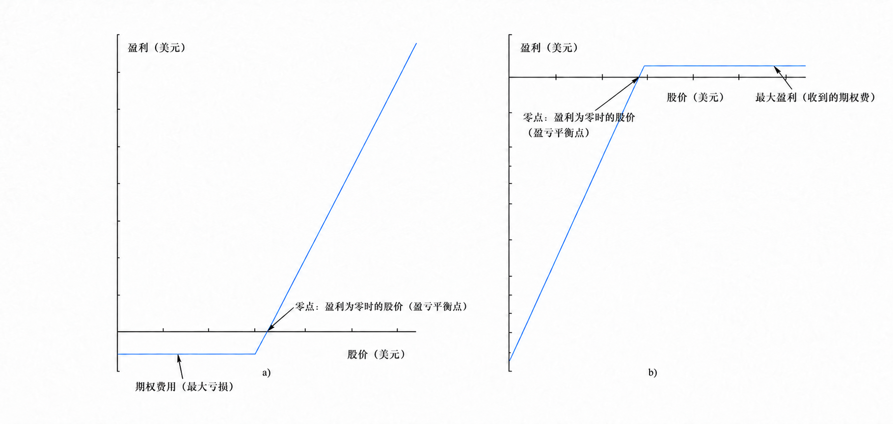

> 思考再三，还是决定整理下这门课的内容（不然感觉要挂科……

# 金融工程概述
金融工程的基本目的：
+ 降低风险——减小损失
+ 发现市场缺陷——寻找套利机会
+ 产品创新——寻找新价值

金融工程的核心问题是定价，常用方法包括：
+ 现金流贴现估值
+ 风险/收益均衡定价
+ 无套利定价【本课程重点】

金融工程的正式定义：综合采用各种工程技术方法设计、开发与实施创新型金融产品（包括金融工具和金融服务），创造性解决各种金融问题。
+ 主要使用的金融工具/产品：期权、期货、远期、互换等金融衍生品
+ 金融工程的研究范围：风险管理理论（风险度量与规避）、金融衍生产品定价、新型金融产品与金融手段开发

## 金融衍生产品简述
金融衍生产品（derviatives）是依附于某种基础资产（也成为标的，往往指其价格）派生出来的产品，也称为金融衍生工具/金融产品/金融工具。  
金融衍生产品的分类如下：
+ 按形态分：远期（forwards）、期货（futures）、期权（options）、互换（swaps）
+ 按标的资产：股权类衍生品、货币衍生品、利率衍生品、商品衍生品等
+ 按权责：风险收益对称/不对称
+ 按复杂程度：普通型/结构性金融衍生品

金融衍生产品对经济环境中的风险转移起到了至关重要的作用（因为已经敲定了买卖价格）。实际上，很多金融产品都有内嵌衍生品的特征。金融衍生产品的主要形态包括：
1. 远期合约：在将来某一指定时刻以约定价格买入或卖出某一产品的合约。【典型例子：外汇远期合约】
    + 交易发生在场外交易市场（OTC）的金融机构之间或金融机构与客户间。场外交易市场的规模远远大于交易所市场，其优点是灵活，合约内容不受交易所的限制；缺点则是存在信用风险、信息不灵通、转手不易、交割麻烦等问题。
    + 不同到期日的远期合约价格可能会有不同
    + 称同意买入资产的一方为长头寸或多头，称同意卖出资产的一方为短头寸或空头。
    + 在合约到期时：
        + 对于长头寸方，合约约定长头寸方必须以$K$的价格买入价值为$S_T$的资产，每一单位的合约收益为$S_T-K$；
        + 对于远期合约的短头寸方，合约所带来的收益为$K-S_T$表中两项收益可正可负。由于进入远期合约的费用为0，所以合约的收益也就是交易员所有的盈利或亏损。
2. 期货合约：可看作标准化的远期，需要在场内交易
    + 期货交易的标的资产涉及商品资产和金融资产
    + 现货价格（立即交割的价格）通常不等于期货价格（将来某一时刻交割的价格）
    + 传统上，期货合约的交易是在交易所中通过公开喊价系统进行的，而如今交易所已逐渐采用电子交易来代替公开喊价系统
3. 期权合约：赋予持有者在给定日期或该日期之前的任意时间以约定的价格执行买入或卖出某种资产的权力（需要支付期权费用）
    + 期权可以在交易所和场外市场进行交易
    + 期权的买方只有权力，而期权的卖方有绝对的义务
    + 期权合约按行权方向可分为**看涨期权**（持有者有权在将来某一确定时间以某一确定价格买入某种资产）和**看跌期权**（持有者有权在将来某一确定时间以某一确定价格卖出某种资产）；按行权时间可分为**美式期权**（可以在到期前的任何时间行使权利）和**欧式期权**（只能在到期日这一特定日期行使权利）

    在一份期权产品中会有行权价格（也称执行价格/敲定价格），以及到期日（最晚行权时间）。一般而言，执行价格增加时，看涨期权的价格会下降，看跌期权的价格会上升；而期权期限增加时，期权价格则都会上升。
    + 看涨期权与看跌期权净盈利与股价的关系示意图如下：

三种合约综合比较：
+ 期权赋予期权所有者某种权力，持有者也可以选择不执行该权力；远期及期货合约则必须执行
+ 期权必须支付期权费，而远期或期货交易不需要任何费用（保证金除外）
+ 交易场所不同（远期：场外交易；期货：交易所；期权：交易所/场外交易）
## 交易员的种类
+ 对冲者：采用期货、远期、期权等行生产品合约来减少自身面临的由于市场变化而产生的风险
    + 对冲可以减小风险，但对冲后的实际效果（以盈利来衡量）并不一定比不对冲的实际效果好。
    + 远期/期货对冲与期权对冲比较：远期/期货合约通过设定买入及卖出标的资产价格来对冲；期权合约为投资者所面临的未来市场不利的价格变化提供保护，同时又允许投资者在价格向有利方面变化时而受益
+ 投机者：利用对一些产品今后市场的变化走向下注
    + 期权会给投资者提供杠杆效应，对于一个给定的投资，期权会放大其最终的效果，好的收益会更好，差的收益可能使投资者丧失全部投资。
    + 对于投机者所取得的杠杆效应，期货和期权比较相似，重要区别在于：
        + 采用期货时，投机者潜在的损失和收益都很大
        + 采用期权，无论市场多糟，投机者的损失都不会超过
所付出的期权费用
+ 套利者：采用两个或更多相互抵消的交易锁定盈利【在下面会有详细分析】
## 补充：利率的计量
年利率为$r$, 当前时刻数量为$A$的货币在$n$年后的终值
+ 单利: $A(1 + rn)$
+ 复利（每年复利1次）: $A(1 + r)^n$
+ 复利（每年复利$m$次，此时为名义利率）: $A(1 + \frac{r}{m})^{mn}$
  + $m = 1$, 与年利率等值
+ 连续复利: $Ae^{rn}$, 也称为利率强度、利息力
+ 与连续复利$R_c$等价的每年$m$次复利利率$R_m$

有效年利率$R_1$、名义年利率$R_m$与连续利率$R_c$的相互转换：
$$
\begin{aligned}
1 + R_1 &= \left( 1 + \frac{R_m}{m} \right)^m = e^{R_c} \Longrightarrow 
\begin{cases}
\displaystyle R_m = m \left[ (1 + R_1)^{1/m} - 1 \right] = m \left( e^{R_c/m} - 1 \right) \\
\displaystyle R_c = m \ln \left( 1 + \frac{R_m}{m} \right)
\end{cases}
\end{aligned}
$$
# 无套利定价原理
无套利分析理论与1958年由莫迪利安尼和米勒在研究企业资本结构和企业价值的关系（即资本结构的MM定理）时提出。
+ MM定理指出，在一个完全/有效市场，融资方式（发行股票和债券）与公司价值无关。
    > 这里的完全/有效市场是指投资者可以无障碍自由交易，且资产价格能够及时、充分地反映市场中可获得的信息。
+ 无套利定价原理属于金融资产（特别是衍生产品）的定价方法，也是定价理论中最基本的原理之一。
+ （无风险）套利的理论定义：一个能产生无风险盈利的交易策略
    + 在实际市场中，指预期只需承受很低风险的盈利策略（即风险套利）
    + （无风险）套利机会的定义：不考虑违约与交易费用，买卖交易时间与买卖交货时间分别完全相同【简单而言就是以低价买入某资产的同时，能够立即以高价卖出】
    + 金融市场的独特性极大地减弱了套利障碍，这是因为：
        + 交易市场的专业化、电子化，金融产品无形化（电子化、数字化）
        + 卖空机制增加了套利机会，且金融产品时间和空间上的多样性使套利更便捷
    + 然而，现实中仍然难以寻找套利机会，因为：
        + 难于寻找相同时间恰好低买高卖同一标的资产的两方
        + 需考虑交易成本/费用：税收、佣金、信息成本、空间成本、时间成本和风险
+ 无套利定价原理的含义：在有效市场中，市场价格必然由于套利行为作出相应的调整，重新回到均衡状态。这种无套利均衡被用于确定金融产品在市场的合理价格，也就是使得市场不存在无风险套利机会的价格。
+ 无风险套利机会存在的等价条件：
    + 存在两个不同的资产组合，它们的未来损益（现金流）相同，但成本不同
    + 存在两个成本相同的资产组合，组合一在所有的可能状态下的损益都不低于组合二，并且至少存在一种状态，在此状态下组合一的损益大于组合二
    + 一个组合成本为0，但在所有状态下损益都不小于0，并且至少存在一种状态使得该组合的损益大于0
+ 由上述等价条件得到的等价推论：
    + 同损益同价格：如果两种证券具有相同的损益，则这两种证券具有相同的价格（也称为“一价定律”）
    + 静态组合复制定价：如果一个资产组合的损益等同于一个证券，那么这个资产组合的价格等于证券的价格（“复制组合”）
    + 动态组合复制定价：若一个自融资交易策略和一证券损益相同，那么该证券价格等于自融资策略的成本（动态套期保值策略）
        + 动态复制与静态复制的主要区别：静态复制在买入固定数量资产后就一直持有到期；而动态复制需要随着市场变化，不断调整投资组合中的资产数量。
        + 自融资策略含义：投资策略建立以后，每一次调整持仓所需的资金，都来自策略内部的资产买卖或者现金账户，不需要投资者额外注入资金，也不允许从组合中无偿取走资金。
## 确定状态下无套利定价原理的应用
理想状态：
+ 市场无摩擦（不存在交易成本）
    + 企业不缴纳所得税
    + 发行证券不需要交易成本
    + 公正的信息披露
    + 与企业有关者可以无成本地解决彼此的利益冲突问题
+ 不考虑违约风险（负债的收益率是无风险收益率）

实际市场一般存在摩擦（交易成本），因此构造的套利策略获得的盈利可能低于交易成本。此时无套利定价原理不能给出确切价格，但可以给出金融产品的价格区间（价格的上、下限）。
+ 价格下限：理论价格 - 最小总交易成本
+ 价格上限：理论价格 + 最小总交易成本
## 不确定状态下无套利定价原理的应用
1. 单步二叉树模型   
    设股票当前价格为$S_0$，期限为$T$的股票期权当前价格为$f$。假设$T$时刻股票价格可能上涨为$S_0u$（相应的期权价值为$f_u$），或下跌至$S_0d$（相应的期权价值为$f_d$）。无风险年利率为$r$（连续复利）。
    - 构造无风险证券组合：$\Delta$股股票多头，1 份期权空头【$\Delta$也称为对冲比率】
    - 无风险组合：$S_0u\Delta - f_u = S_0d\Delta - f_d \Longrightarrow \Delta = \dfrac{f_u-f_d}{S_0u-S_0d}$
    - 根据构造组合的成本 = 组合价值的贴现，得到
    $$
    S_0\Delta - f = (S_0u\Delta - f_u)e^{-rT} = (S_0d\Delta - f_d)e^{-rT}\Longrightarrow f = e^{-rT}[pf_u + (1-p)f_d], \quad p = \frac{e^{rT}-d}{u-d}
    $$
2. 两步二叉树模型   
    一般在动态组合复制定价中使用，核心仍然是用风险中性原理从后向前反推定价（拆成多个单步二叉树模型计算）